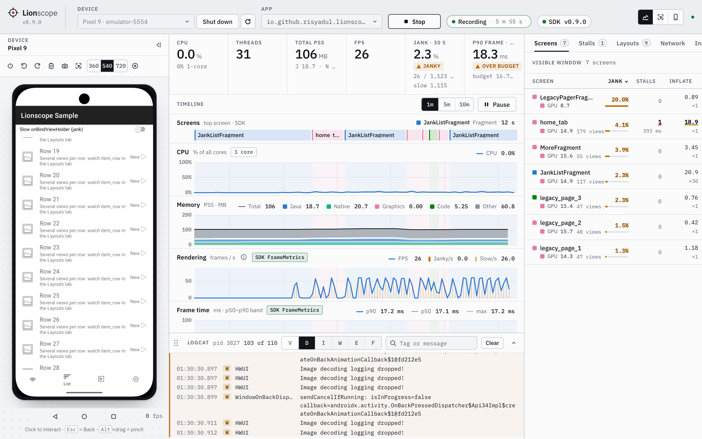

# Lionscope

Lionscope is a lightweight Android profiler and Layout Inspector in your browser, and your AI agent can use it
too. No Android Studio needed: run `npx lionscope@latest`, pick a device and an app.

- **Profile**: CPU, memory, frame rendering, main-thread stalls, layout inflation and logcat for one app, on a
  single shared time axis. With the SDK, each stall names the line that blocked and where its work came from (an
  RxJava chain and the line that subscribed it, a coroutine, a posted Runnable, a click).
- **Inspect**: freeze the screen, click a view, and see its attributes; with the SDK, also the XML layout and
  line it came from and the Fragment that owns it, the composables of Compose screens with the Kotlin line that
  calls them, and live edits of a View's properties (padding, size, colors with a picker, text…) on the running
  app.
- **Network**: with the SDK's OkHttp interceptor, see the app's HTTP requests (headers, bodies, timings) on the same
  time axis, and mock responses or failures from the dashboard.
- **Operate**: see and control emulators (which it can also boot headless) and USB devices right next to the
  charts, and move them to another location on a map.
- **AI agents**: the same data as tools over MCP or a CLI (Claude Code, Cursor, VS Code, Codex, …). Select a view
  in the Inspector and ask your agent about "this element".

It stays light. Measured with the sample app on an emulator, the server uses under 1% of one CPU core while the
app is idle and about 4% while it scrolls, with 100–150 MB of memory. The SDK adds about 0.5% CPU in the app.

It works in two modes:

- **ADB-only** (no app changes): everything is collected through `adb shell` (`/proc`, `dumpsys`, `logcat`).
- **With the optional SDK** in the app's **debug** build: adds which screen is on top (Activity, Fragment,
  DialogFragment), per-frame `FrameMetrics` with a stage-by-stage breakdown, grouped per screen, and main-thread
  stalls with the app code line that caused them and where their work came from (plus opt-in StrictMode
  violations), layout inflation timing, the Layout Inspector's own view tree with layout sources and owners, the
  composables of Compose screens, live edits of Views, and (with one line in your `OkHttpClient`) the app's HTTP
  traffic and mock responses.

<picture>
  <source media="(prefers-color-scheme: dark)" srcset="docs/images/dashboard-dark.png">
  
</picture>

<sub>The bundled sample app on a headless emulator, operated from the Device column: screen bands across all
charts, SDK FrameMetrics in the Rendering lane, logcat below the timeline, and the Screens tab ranking the
screens by jank.</sub>

<!-- docs:added -->

## What the dashboard shows

One page: the device, the charts on one time axis, logcat and, with the SDK, the Screens, Stalls, Layouts and
Network tabs. See [What the dashboard shows](docs/dashboard.md), and each part in detail:

- [Finding the line that blocks the main thread](docs/features/stalls.md)
- [Layouts: what inflating XML costs](docs/features/layouts.md)
- [Layout Inspector: pick a view, see where it came from](docs/features/layout-inspector.md), and editing views live
- [Network: requests and mocks](docs/features/network.md)
- [Saved state: what makes it too large](docs/features/saved-state.md)
- [Operating the emulator or a physical device from the dashboard](docs/features/device.md)
- [Changing the device's location](docs/features/location.md)

<!-- /docs:added -->

## Requirements

- Node.js ≥ 22.12
- Android SDK platform-tools (`adb`). Lionscope looks for it in `LIONSCOPE_ADB`, `$ANDROID_HOME`,
  `$ANDROID_SDK_ROOT`, `~/Library/Android/sdk`, then `PATH`.
- A device or emulator with USB debugging enabled, running Android 7.0 (API 24) or newer (Lionscope relies on
  `pidof`, toybox `date +%s%3N` and a non-PTY `adb shell`).

## Quick start

```bash
npx lionscope@latest
# open http://localhost:8701
```

`@latest` makes npx check for a new release; a bare `npx lionscope` can keep running a version it cached
earlier.

From source instead (the npm package may lag the latest git tag):
`git clone https://github.com/risyadul/Lionscope.git && cd Lionscope && npm install && npm run lionscope`.

Pick the device, pick the app, press **Start**. Nothing needs to be installed on the device for the ADB-only
mode. `npx lionscope --help` lists the options (`--port`, `--device-port`, `--adb`, `--allow-device-control`,
`--allow-network-bodies`)
and the `mcp` and `query` commands for [AI agents](docs/agents.md); the
[`lionscope`](https://www.npmjs.com/package/lionscope) package is a single bundled file plus the built
dashboard, with no runtime dependencies.

## Adding the SDK (optional, debug builds only)

The SDK is published on [JitPack](https://jitpack.io/#risyadul/Lionscope). It is a public artifact: no
credentials or opt-in property are needed.

```groovy
// settings.gradle (dependencyResolutionManagement) or app/build.gradle repositories
maven { url "https://jitpack.io"; content { includeGroup "com.github.risyadul.Lionscope" } }
// app/build.gradle
debugImplementation "com.github.risyadul.Lionscope:lionscope:0.12.0"
```

If the project uses `dependencyResolutionManagement`, the `maven` block goes in `settings.gradle`; otherwise
in the module's `repositories`. The `content { includeGroup … }` filter keeps JitPack from serving anything
except Lionscope.

No code changes are needed: the SDK starts itself through androidx.startup, and only does anything in a
debuggable build and in the app's main process. When a session starts, the server runs
`adb reverse tcp:8700 tcp:<gateway port>` for the selected device itself and removes it when the session stops.
If an app removes androidx.startup's `InitializationProvider`, call `Lionscope.install(context)` from
`Application.onCreate`.

<!-- docs:added -->

Apps that call the SDK's API (`Lionscope.install()`, `Lionscope.trackNavigation()`,
`Lionscope.okHttpInterceptor()`, …) also need the `lionscope-noop` artifact in release builds. That, screen names,
Navigation Compose, the Network interceptor and what the SDK costs when no dashboard is connected are in
[The SDK](docs/sdk.md).

## Use with AI agents

AI coding agents (Claude Code, Cursor, VS Code, Codex, …) get the dashboard's data as tools, over MCP
(`npx -y lionscope mcp`) or the shell (`npx lionscope query <tool>`). Tools that operate the device stay off unless
you add `--allow-device-control`. Setup for each client, the tools, the agent skill and the safety notes
are in [Use with AI agents](docs/agents.md).

## Architecture

The server, the dashboard, the SDK and how they connect: [Architecture](docs/architecture.md).

## Security model

What the server accepts, from where, and what reaches an agent: [Security model](docs/security.md).

## Known limitations

See [Known limitations](docs/limitations.md).

## Configuration

Flags and environment variables: [Configuration](docs/configuration.md).

## Development

Building and testing from source: [Development](docs/development.md).

<!-- /docs:added -->

## License

Licensed under the [Apache License, Version 2.0](LICENSE). See [NOTICE](NOTICE).
