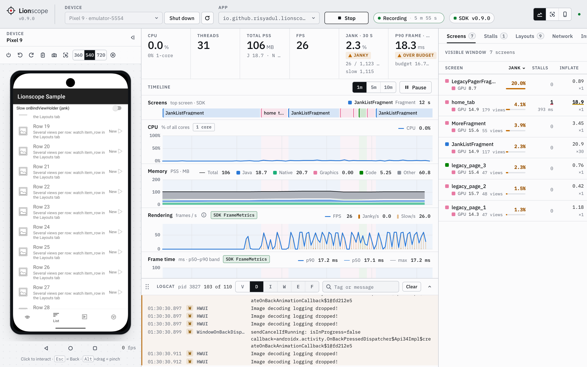
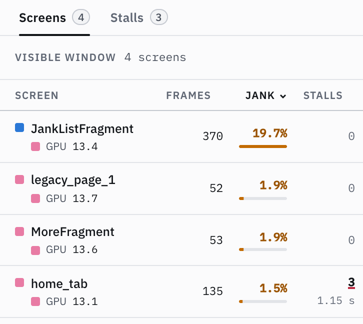
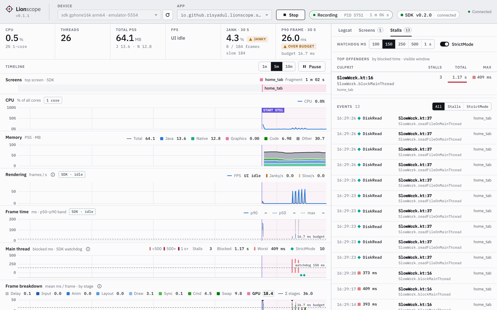
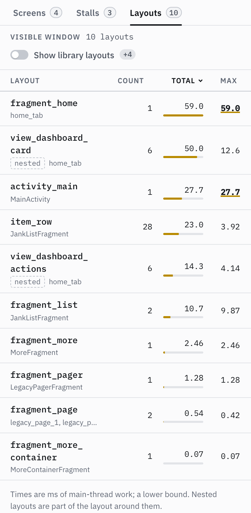
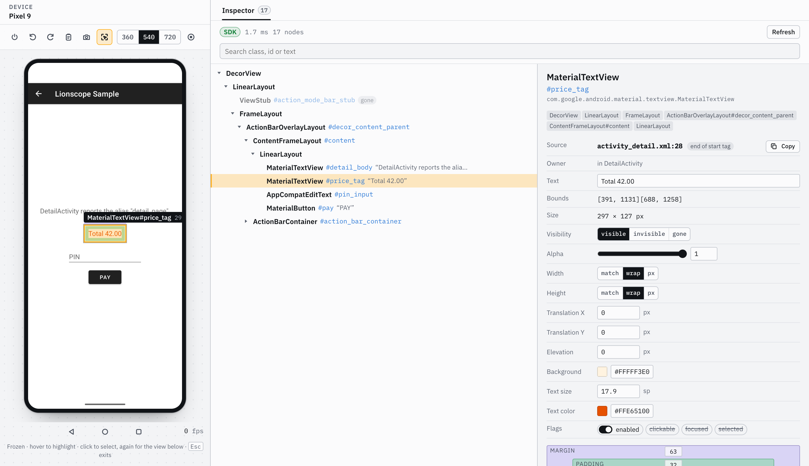

# Lionscope

Lionscope is a lightweight Android profiler and Layout Inspector in your browser, and your AI agent can use it
too. No Android Studio needed: run `npx lionscope@latest`, pick a device and an app.

- **Profile**: CPU, memory, frame rendering, main-thread stalls, layout inflation and logcat for one app, on a
  single shared time axis.
- **Inspect**: freeze the screen, click a view, and see its attributes; with the SDK, also the XML layout and
  line it came from and the Fragment that owns it.
- **Operate**: see and control emulators (which it can also boot headless) and USB devices right next to the
  charts.
- **AI agents**: the same data as tools over MCP or a CLI (Claude Code, Cursor, VS Code, Codex, …). Select a view
  in the Inspector and ask your agent about "this element".

It stays light. Measured with the sample app on an emulator, the server uses under 1% of one CPU core while the
app is idle and about 4% while it scrolls, with 100–150 MB of memory. The SDK adds about 0.5% CPU in the app.

It works in two modes:

- **ADB-only** (no app changes): everything is collected through `adb shell` (`/proc`, `dumpsys`, `logcat`).
- **With the optional SDK** in the app's **debug** build: adds which screen is on top (Activity, Fragment,
  DialogFragment), per-frame `FrameMetrics` with a stage-by-stage breakdown, grouped per screen, and main-thread
  stalls with the app code line that caused them (plus opt-in StrictMode violations), layout inflation timing,
  and the Layout Inspector's own view tree with layout sources and owners.

<picture>
  <source media="(prefers-color-scheme: dark)" srcset="docs/images/dashboard-dark.png">
  
</picture>

<sub>The bundled sample app on a headless emulator, operated from the Device column: screen bands across all
charts, SDK FrameMetrics in the Rendering lane, logcat below the timeline, and the Screens tab ranking the
janky list first.</sub>

## What the dashboard shows

The dashboard is a single page: a top bar to pick the device and the app and to start or stop a session; the
emulator's screen on the left; stacked timeline charts in the middle that share one time axis (last 1, 5 or 10
minutes) and can be paused, with the app's logcat in a drawer below them (drag its bar to resize it,
double-click the bar to maximise it; click, shift-click or Cmd/Ctrl-click lines and press Cmd/Ctrl+C to copy
them); and, with the SDK, the Screens, Stalls and Layouts tabs on the right. Below 1280 px the screen opens as a
drawer from the top bar (in the Profiler view; the other two keep it on the page).

The switch at the right of the top bar picks what the page is for:

- **Profiler** (the default): everything above.
- **Inspector**: only the device and the [Layout Inspector](#layout-inspector-pick-a-view-see-where-it-came-from),
  which gets the room to show its tree and the attributes side by side.
- **Device**: only the device screen, larger, with how to let an AI agent operate it (see
  [Use with AI agents](#use-with-ai-agents)).

The Inspector and Device views hide the charts and logcat and stop drawing them, so nothing hidden keeps
redrawing in the browser; a running session keeps recording, and the charts and logcat (with its filters) are
there as you left them when you switch back. The
view is part of the address (`http://localhost:8701/?view=inspect`, `?view=device`), so you can bookmark it, and
the page remembers the last one you used.

| Panel                                                 | Source                                                                                   | Interval |
| ----------------------------------------------------- | ---------------------------------------------------------------------------------------- | -------- |
| CPU % + threads                                       | `/proc/<pid>/stat`                                                                       | 1 s      |
| Memory (PSS: Java / Native / Graphics / Code / Other) | `dumpsys meminfo --local <pid>`                                                          | 3 s      |
| Frames (FPS, jank, p50/p90 frame time)                | `dumpsys gfxinfo <pid> framestats reset` (+ `/proc/uptime` for device-side elapsed time) | 0.5 s    |
| Logcat (app PID only)                                 | `logcat -v epoch --pid=<pid>`                                                            | stream   |
| Process start / restart / died markers                | `pidof <pkg>`                                                                            | 1 s      |

With the SDK installed in the app's debug build, the dashboard also shows:

| Panel                                             | Source (in-app SDK)                                         |
| ------------------------------------------------- | ----------------------------------------------------------- |
| Screens lane + tint across all charts             | Activity / Fragment / DialogFragment lifecycle (top screen) |
| Rendering / Frame time (source `SDK`)             | `Window.OnFrameMetricsAvailableListener` (API 24+)          |
| Frame breakdown (input … swap, delay, GPU)        | FrameMetrics stages, aggregated per 500 ms                  |
| Per-screen table (frames, jank %, p90, top stage) | the above, grouped by screen                                |
| Main thread lane (one bar per stall)              | Main-thread watchdog; StrictMode violations as ticks        |
| Stalls tab (offenders, events, stack detail)      | Sampled main-thread stacks; StrictMode violations (opt-in)  |
| Layouts tab, Inflate column, gold lane markers    | XML layout inflation timing (Android 10+)                   |
| Views column (count and depth per screen)         | View hierarchy snapshot after a screen's first frame        |

While SDK frames flow, `gfxinfo` polling pauses (no double observation, no `reset` clash); it resumes 3 s after
they stop. The dashboard shows whether the SDK is connected (and its version), or how to add it.



<sub>The Screens tab ranks screens by jank % and names the dominant frame stage for each one (p90 and slow frames
join in when the panel is wider). Names come from the app's own screen alias when it has one (`home_tab`,
`legacy_page_1`), otherwise from the class.</sub>



<sub>The Stalls tab after tapping the sample's "Block main thread" button three times from the Device column: the
offenders table names the line that blocked the main thread and the screen it happened on, and each stall is
listed with its duration; with StrictMode on, disk and network violations join the list with their stacks.</sub>

### Finding the line that blocks the main thread

With the SDK (0.2.0+ SDK and server), a watchdog thread posts a tick to the main thread every 50 ms. When a
tick is not run within the threshold, it samples the main thread's stack every 50 ms until the block ends, then
reports one stall: when it started, how long it lasted, the screen on top, and the most frequent sampled stack
(a block is cut at 30 s). The dashboard ranks stalls by their culprit line (`Class.method (File.kt:87)`): the
first app frame, skipping generated ViewBinding/DataBinding classes for the code that inflates them; when no app
frame was on the stack, the first library frame outside the Android, Java, Kotlin and AndroidX packages (a
third-party SDK blocking the main thread). It shows the stack with framework frames collapsed, and flags stalls
that happened while a debugger was attached.
The threshold is chosen in the Stalls tab (100, 150, 250, 500 or 1000 ms; default 150 ms). The watchdog runs only
while a dashboard is connected at protocol v2 and an activity is started.

**StrictMode (opt-in, off by default).** The Stalls tab has a toggle for it (Android 9 / API 28+). When on, the
SDK extends the app's current main-thread and process StrictMode policies with disk read/write, network, custom
slow call and leaked-closable detection, and reports each violation with its stack. It restores the app's
policies when you turn it off or the link closes. It refuses to touch a policy that has a death, dialog, flash
or dropbox penalty, or that looks like it has the app's own `penaltyListener`, and it never re-arms a
death-on-network penalty; the Stalls tab then says nothing was added. Violations are coalesced to one per second
per stack, and at most 10 per second overall.

### Layouts: what inflating XML costs

With the SDK (0.4.0+ SDK and server), the **Layouts** tab lists the XML layouts the app inflates on the main
thread through an `AppCompatActivity`'s inflater: how often, total, mean and slowest time, the views created by
the slowest inflation, and the screens it ran on. It is sorted by total time; click a column to sort by it.
Layouts that come from the Android framework or libraries (`abc_`, `mtrl_`, `design_`, …) are hidden until you
switch on **Show library layouts**. A layout the SDK cannot name is shown by its first view and XML line
(`Button:12`, in italics). A layout inflated inside another one (an `<include>`, or a compound view's own
layout) gets its own row, marked **nested**, because that is its own cost; but its time is already part of the
layout around it, so the row is not extra time.



<sub>The Layouts tab after opening the sample's screens: `fragment_home` is the slowest single inflation, its
included cards (`view_dashboard_card`, nested) make up most of it, and `item_row` adds up over 28 RecyclerView
rows.</sub>

The Screens tab gets an **Inflate** column (inflation time on that screen, each inflation counted once and nested
ones left out, the slowest layout in the tooltip) and a **Views** column (views and depth from the screen's
latest view tree, the deepest path in the tooltip). Top-level inflations of 16 ms or more also appear as gold
bars on the rail under the Main thread lane's baseline; hover one for the layout, its time, its views and the
screen, click it to open the Layouts tab.

How it is measured: the SDK installs a `LayoutInflater.Factory2` on each Activity before it is created and
times view creation from the first view of a layout to the last, then hands the work on (AppCompat's view
substitution, `MaterialButton` and friends, is untouched). No Gradle plugin and no app changes. Read the figures
as a **lower bound**: parser setup is not included, and a debuggable build is slower than release.
What is **not** measured: inflation through the application context or in a `Service`, on a background thread,
in Activities created while tracking was off, in Activities that already had a `LayoutInflater` factory, and
in screens that are not `AppCompatActivity` (plain `Activity` and `ComponentActivity` screens; their view trees
are still taken). Layout measuring needs
**Android 10 (API 29)+**; below that the tab says so and nothing is installed. Inflation tracking is on by
default and has a switch next to StrictMode in the Stalls tab. Turning it off stops recording, and screens
opened afterwards get no factory at all (also across reconnects, until a session turns it back on); screens
opened while it was on keep theirs.

**If your app sets its own factory.** The SDK only installs its factory when the Activity's inflater has none.
If the app (or a library) later calls `LayoutInflater.setFactory2` on that same inflater, for example in
`onCreate` after `super.onCreate`, Android throws `A factory has already been set on this LayoutInflater`. The
dashboard switch can't help there, because the first Activity is created before the SDK hears from the server.
Turn inflation measuring off for the app in its debug manifest instead (view trees keep working):

```xml
<!-- src/debug/AndroidManifest.xml -->
<application>
    <meta-data android:name="io.github.risyadul.lionscope.inflateTracking" android:value="false" />
</application>
```

And please open an issue with the stack trace.

**View trees.** Once per screen visit, after its first frame and when the main thread is idle, the SDK walks
the window's view hierarchy (iteratively, capped at 20,000 views) and reports the number of views and view
groups, the depth, the path to the deepest view and the most common view classes. This works on every API level
the SDK supports, including those below Android 10.

### Layout Inspector: pick a view, see where it came from

Press **Inspect** in the device toolbar (an emulator or a physical device, no profiling session needed). The
screen freezes to a snapshot and the **Inspector** tab opens next to Layouts. Hover to highlight the view under
the pointer (its `Class#id` and size appear on the box); click to select it. The selection shows its padding and
margin on the screen and its attributes in the tab: class, id, text, bounds and size, visibility, alpha, layout
width and height, padding, margin, flags, the owning Fragment and Activity, and the **XML layout and line** it
was inflated from (`fragment_cart.xml:33`). On Compose screens the nodes are **composables** (`Button`,
`ProductCard`) with the **Kotlin file and line they are called from** (`CartScreen.kt:87`). The tree beside it
collapses, follows the selection, takes the arrow keys (↑↓ move, → opens, ← closes) and searches class, id, text,
source file and destination; hovering a row lights up the view on the screen. `Esc` or the toggle goes back to the live screen. While Inspect is on the snapshot refreshes about 0.7 s
after the app changes its top screen (never continuously), and the refresh button takes a new one.



- **Where the tree comes from.** With the SDK in the app (Lionscope 0.5.0 or later) the SDK walks the app's own
  views and the badge reads `SDK`. From SDK 0.5.2 on this needs no profiling session: while a dashboard shows the
  Inspector for a device (the Inspector view or tab), and for 5 minutes after the last Inspect of it (yours or an
  agent's), the server keeps an inspect-only link to the debuggable SDK apps on that device. On that link the SDK
  only reports which screen is on top and answers Inspect: no frames, watchdog, StrictMode or layout reports until
  you press Start. The first Inspect after the link appears can wait up to 6 s for the app to connect (the badge
  then says `SDK connecting` if it didn't). Apps with SDK 0.5.0 or 0.5.1 still link only during a session (badge:
  `SDK needs a session`), and if another Lionscope server already holds the device's link the badge says
  `SDK link busy`. On Android 10 and later that is every window of the app, dialogs included; below
  Android 10 it is the top Activity and its dialogs, and without layout sources. From 0.6.0 the SDK also reads
  Compose (below). Otherwise (no SDK in the app, an older SDK, Compose it cannot read, other apps and system UI) the
  server falls back to the accessibility tree, read by its UI helper (see the agent tools' notes on its side
  effects) or `uiautomator dump`, and the badge says `uiautomator` with the reason. uiautomator has fewer nodes and
  no source, owner, padding or margin; those fields show a dash.
- **Compose.** The SDK reads the composition of every `ComposeView` (a `setContent {}` Activity, a ComposeView in
  an XML layout, a Compose dialog or popup window), the way Android Studio's Layout Inspector does: it turns
  Compose's tooling data on when it starts, before anything is composed. A node is a composable **called from your
  code**, so `Button` is one but the `Surface`, `Row` and `Layout` inside it are not (calls whose call site is in
  androidx Compose, Material or Navigation are folded into the nearest composable you called; a third-party
  library's internals do show). Its source is the **call site**: the file and line of the call, not where the
  function is defined. Its id is its `testTag`; text, content description and flags come from its semantics;
  lazy list items sit under their list, an `AndroidView`'s View under its composable, a `ComposeView` under the
  XML views around it. Bounds are the content box of what it lays out (inside its padding modifiers); composables
  have no alpha, padding, margin or layout params. With `Lionscope.trackNavigation` (below) the owner shows the
  navigation destination a composable is drawn for. Works with Jetpack Compose 1.6 and later and Compose
  Multiplatform 1.8+ on Android, compiled with source information (the default for debug builds).
- **When Compose falls back.** A Compose screen that was composed before the SDK started (Lionscope installed by
  hand late, or the app opted out with `<meta-data android:name="io.github.risyadul.lionscope.composeInspection"
android:value="false" />`) cannot be read: the badge says why (restart the app). So does a build without
  Compose source information. The tooling data makes composition a little slower and keeps a little more in
  memory (as under Android Studio's inspector), so debug frame timings of Compose screens lean slightly
  pessimistic. A capture runs on the main thread: about 10 ms for a 30-item lazy list on an emulator, several
  times that on a slow phone.
- **The line number is where the start tag ends.** aapt2 records the line of the closing `>`, so a `Button` that
  spans lines 28 to 33 reports 33. Views built in code, ViewStubs and views inflated off the main thread have no
  source, and neither do the views of an Activity that was created while inflation tracking was off (or opted out
  of in the SDK) — turn it on and reopen the screen.
- **Privacy.** The screenshot and the text on screen stay on your machine, and the snapshot is kept in the
  server's memory only (the last few). Password fields are never read: for Compose, text fields with password
  semantics (`PasswordVisualTransformation`, secure text fields) or a password content type. A Compose field
  that only sets `KeyboardType.Password` shows its text on screen and is read like any other. An AI agent sees text and a cropped image
  only for an element _you_ selected (never for a whole window or a large part of the screen); an element the
  agent selects itself gives it structure only (class, id, layout source, owner, bounds). A view an agent
  selected is marked **AI** in the dashboard. See "Use with AI agents".

### Operating the emulator from the dashboard

The device picker lists every AVD, also the ones that are off. **Boot** starts one without a window on the host
GPU (`-no-window -gpu host`), as a **Quick boot** (loads the Quick Boot snapshot and saves it on shutdown) or a
**Cold boot** (`-no-snapshot-load`). Its screen then shows in the Device column, where you use it like the
emulator window: click and drag to touch, Alt+drag to pinch (two fingers mirrored around the centre), scroll
with the wheel, type when the screen has focus (Esc is Back), and use the toolbar for
Back, Home, Recents, Power, rotation, a full-resolution screenshot and the frame size (360, 540 or 720 px along
the short edge). Mirroring works with or without a profiling session, and only streams while the column is
open and the tab is visible.

**Share clipboard** (toolbar, on by default) keeps the clipboards in step: text you copy on your computer is put
on Android's clipboard when you click or focus the screen, so Android's own long-press **Paste** has it, and
text copied inside Android lands on your computer's clipboard ("Copied from the emulator"). Cmd/Ctrl+V on the
screen pastes straight into the focused field. Any Unicode text up to 32 KB works. Reading your clipboard needs
the browser's clipboard permission (Chrome asks once); Firefox-based browsers (Firefox, Zen) and Safari don't offer it,
so there press Cmd/Ctrl+V on the screen to send your clipboard (the screen shows that hint); copying out of
Android works everywhere. Turn the toggle off and nothing is read from or written to either clipboard
(Cmd/Ctrl+V still pastes, as an explicit action).

**Shut down emulator** (in the Device column and next to the device picker) closes any running emulator, after
stopping a profiling session on it. Lionscope asks first when the emulator wasn't booted by Lionscope (for example
Android Studio) or a session is running. Emulators Lionscope booted are also shut down when the server stops; one
you started yourself never is.

Lionscope talks to the emulator's own gRPC endpoint, found through the emulator's discovery file
(`avd/running/pid_<pid>.ini`, which holds its port and access token). Frames are captured by the emulator on
the host side and sent as PNG only when the screen changes, so Android inside the emulator does no extra work
and the app's measurements are not affected. On an M-series Mac at 540 px that is about 58 fps, ~140 KB per
frame and ~55 ms from input to frame.

If an emulator renders in software (SwiftShader, e.g. `-no-window` without `-gpu host`), the dashboard warns:
frame times are then not representative of a device.

### Operating a physical device from the dashboard

Pick a phone connected over USB and its screen shows in the Device column, with the same controls as an
emulator (touch, multi-touch, wheel, keys, Share clipboard, Back / Home / Recents / Power, rotation where the app
allows it, screenshot and frame size). Nothing is installed on the phone: Lionscope pushes the bundled
[scrcpy](https://github.com/Genymobile/scrcpy) server (v5.0.1, Apache-2.0, checked against its published SHA-256)
to `/data/local/tmp`, runs it over adb while the column is open, and it removes itself when mirroring stops. The
phone's screen stays on while it is mirrored (scrcpy's `stay_awake`); the previous setting comes back afterwards.
The phone's hardware encoder sends H.264 video that the browser decodes with WebCodecs (Chrome, Firefox 130+,
Safari 16.4+; the dashboard must be opened on `localhost`).

The phone's hardware encoder does add a little work while it is mirrored, so close the Device column for the
cleanest measurements.

On Xiaomi / HyperOS (and some other OEM builds) the phone refuses injected input until **USB debugging (Security
settings)** is turned on in Developer options; the screen still mirrors and the dashboard tells you what to turn
on.

## Requirements

- Node.js ≥ 22.12
- Android SDK platform-tools (`adb`). Lionscope looks for it in `LIONSCOPE_ADB`, `$ANDROID_HOME`,
  `$ANDROID_SDK_ROOT`, `~/Library/Android/sdk`, then `PATH`.
- A device or emulator with USB debugging enabled, running Android 7.0 (API 24) or newer (Lionscope relies on
  `pidof`, toybox `date +%s%3N` and a non-PTY `adb shell`).

## Quick start

```bash
npx lionscope@latest
# open http://localhost:8701
```

`@latest` makes npx check for a new release; a bare `npx lionscope` can keep running a version it cached
earlier.

From source instead (the npm package may lag the latest git tag):
`git clone https://github.com/risyadul/Lionscope.git && cd Lionscope && npm install && npm run lionscope`.

Pick the device, pick the app, press **Start**. Nothing needs to be installed on the device for the ADB-only
mode. `npx lionscope --help` lists the options (`--port`, `--device-port`, `--adb`, `--allow-device-control`)
and the `mcp` and `query` commands for [AI agents](#use-with-ai-agents); the
[`lionscope`](https://www.npmjs.com/package/lionscope) package is a single bundled file plus the built
dashboard, with no runtime dependencies.

## Adding the SDK (optional, debug builds only)

The SDK is published on [JitPack](https://jitpack.io/#risyadul/Lionscope). It is a public artifact: no
credentials or opt-in property are needed.

```groovy
// settings.gradle (dependencyResolutionManagement) or app/build.gradle repositories
maven { url "https://jitpack.io"; content { includeGroup "com.github.risyadul.Lionscope" } }
// app/build.gradle
debugImplementation "com.github.risyadul.Lionscope:lionscope:0.5.1"
```

If the project uses `dependencyResolutionManagement`, the `maven` block goes in `settings.gradle`; otherwise
in the module's `repositories`. The `content { includeGroup … }` filter keeps JitPack from serving anything
except Lionscope.

No code changes are needed: the SDK starts itself through androidx.startup, and only does anything in a
debuggable build and in the app's main process. When a session starts, the server runs
`adb reverse tcp:8700 tcp:<gateway port>` for the selected device itself and removes it when the session stops.
If an app removes androidx.startup's `InitializationProvider`, call `Lionscope.install(context)` from
`Application.onCreate`.

**Screen names.** By default a screen is named after its class (`CheckoutActivity`, `HomeFragment`). If the
Activity or Fragment has a public zero-arg `getScreen()` that returns an object with a non-blank String
`value` (`getScreen()?.value`, e.g. an enum implementing a `ScreenName` interface), that alias is used instead.
The sample app's `ScreenName.kt` is an example of this convention; the SDK reads it through reflection, so no
shared interface is required.

**Navigation Compose.** A single-Activity Compose app is one Activity to the SDK. Tell it about your
`NavController` and every destination becomes a screen (the Screens lane, per-screen jank, stalls, the Inspector's
screen and owner):

```kotlin
val navController = rememberNavController()
Lionscope.trackNavigation(navController) // once per controller; repeated calls are free
NavHost(navController, startDestination = "catalog") { /* ... */ }
```

The screen is the destination's **route pattern**, never its arguments: `product/{id}` (query placeholders are
dropped from the name), or for a type-safe route its class name (`ProductDetail`); a `dialog()` destination is a
dialog. It applies while no Fragment of your app is on top, and with nested NavHosts the innermost shown one wins
(track each). `lionscope-noop` has the same call, so it compiles in release builds. In Kotlin Multiplatform
(Compose Multiplatform with `org.jetbrains.androidx.navigation:navigation-compose`), the SDK is an Android
dependency, so call it from `androidMain`, e.g. through an `expect`/`actual` function:

```kotlin
// commonMain
@Composable expect fun TrackNavigation(navController: NavHostController)
// androidMain
@Composable actual fun TrackNavigation(navController: NavHostController) = Lionscope.trackNavigation(navController)
// iosMain (and other targets)
@Composable actual fun TrackNavigation(navController: NavHostController) = Unit
```

Voyager and Navigation 3 are not tracked yet.

SDK details: minSdk 23 (frame metrics need API 24), Java 8 bytecode, Kotlin metadata 2.0, no runtime
dependencies besides `androidx.startup` (`androidx.fragment`, Compose UI, Navigation and the Kotlin stdlib come
from the host app, and are only used when it has them).
Demo app: [`android-sdk/sample`](android-sdk/sample).

### Keeping it out of release builds

`debugImplementation` means release builds contain nothing from Lionscope: no classes, no
`InitializationProvider` entry, no `INTERNET` permission added by the SDK. As a second guard, the SDK does
nothing unless the app is debuggable (`FLAG_DEBUGGABLE`).

Apps that call the API explicitly (`Lionscope.install()`, `Lionscope.isActive()`, `Lionscope.trackNavigation()`)
also need it to compile in release; for them there is a no-op artifact with the same API:

```groovy
releaseImplementation "com.github.risyadul.Lionscope:lionscope-noop:0.5.1"
```

### Cost when no dashboard is connected

- Lifecycle callbacks only record the current top screen; nothing is sent while there is no connection.
- `FrameMetrics` listeners are registered only while the dashboard has accepted the app (an active session for
  that package), so there is no per-frame work otherwise.
- The SDK tries to reach `127.0.0.1:8700` every 1 → 2 → 5 s while the app is in the foreground (a refused
  local connection when nothing listens), slows to every 15 s after 10 minutes of foreground time without a
  dashboard, and stops trying 30 s after the app goes to the background until it comes back.
- The main-thread watchdog thread exists only while a dashboard has accepted the app at protocol v2 and an
  activity is started; StrictMode is off until you enable it, and its reporter thread stays idle (no work)
  after the first enable.
- Its threads run at background priority (except the frame-metrics and watchdog threads, which must not be
  starved while the app is busy); a bounded outbound queue drops the oldest messages instead of growing; SDK errors are contained and
  never reach the app's crash handler.

## Use with AI agents

AI coding agents (Claude Code, Cursor, VS Code, Codex, Gemini CLI, Windsurf, Claude Desktop, …) can read what
Lionscope records and run profiling sessions: "profile the shop app on the emulator, then tell me which screen
janks most and which line blocks the main thread". They get the same numbers the dashboard shows (the Screens,
Stalls, Layouts and Logcat figures come from one shared module), and the dashboard stays open next to them.

Three ways in, one set of tools:

- **MCP over stdio**: `npx -y lionscope mcp`. It uses the Lionscope server already running on `--port` (default
  8701), or starts one in its own process when none is running: the dashboard is then at
  http://localhost:8701 until the agent disconnects. If the server it uses stops, its next tool call starts one
  (or attaches to whichever another client started). Logs go to stderr.
- **MCP over HTTP** (Streamable HTTP): `http://localhost:8701/mcp` on a running server (`npx lionscope`), for
  clients that are not web pages: a request with an `Origin` other than the dashboard's is refused. Desktop
  harnesses connect from a Node process and send none (VS Code's and Cursor's MCP clients run in their Node extension hosts);
  browser-based clients (VS Code for the Web, an MCP inspector page) can't use it, so give them the stdio
  command.
- **Shell**: `npx lionscope query <tool>` prints a tool's JSON result, for agents that can only run commands.

| Tools                      | What they do                                                                                                                                                                                                                                                                                                                                                                                                                         |
| -------------------------- | ------------------------------------------------------------------------------------------------------------------------------------------------------------------------------------------------------------------------------------------------------------------------------------------------------------------------------------------------------------------------------------------------------------------------------------ |
| Read (always)              | `status` (devices, emulators, session, SDK link), `list_apps`, `get_summary` (CPU, memory, FPS, jank, stalls, top screens and layouts of the last 1/5/10 min), `get_screens`, `get_stalls`, `get_strictmode`, `get_layouts`, `get_view_tree`, `search_logcat`                                                                                                                                                                        |
| Session (always)           | `start_session`, `stop_session`, `set_sdk_options` (stall threshold, StrictMode, inflation tracking)                                                                                                                                                                                                                                                                                                                                 |
| Inspector (always)         | `get_inspector_selection` (the element you selected in the dashboard's Layout Inspector: its attributes, a view's XML layout and line or a composable's Kotlin call site, owning Fragment, Activity and destination, ancestors and children, and a crop of the screenshot; structure only for a node the agent selected), `select_inspector_node` (highlights a node in the dashboard, marked AI)                                    |
| Device (opt-in, see below) | `get_ui_tree` (the screen's elements: text, description, id, bounds, flags), `inspect_screen` (a Layout Inspector snapshot, shown in the dashboard too), `tap_element`, `wait_for`, `scroll_to` (find elements by text, id or description), `screenshot` (720 px short edge), `tap`, `swipe`, `type_text`, `press_key` (navigation and editing keys; never power, sleep or lock), `launch_app`, `boot_emulator`, `shutdown_emulator` |

**"Why is this button misaligned?"** Select the element in the dashboard's Layout Inspector (Inspect, then click
it) and ask about "this element": the agent calls `get_inspector_selection` and gets what the Inspector tab
shows (class, id, text, bounds, padding, margins, layout width and height, `view_dashboard_actions.xml` line 15,
the owning Fragment) plus a cropped screenshot of the element, at most 512 px (none for a window root or an element
covering more than half of the screen). The line is where the start tag ends, which the tool says too. With
device control on, `inspect_screen` takes a snapshot itself (with a query to find nodes; it replaces the snapshot
you see) and `select_inspector_node` points you at the node it means, marked **AI**. For a node the agent selected
itself, `get_inspector_selection` returns its structure only (class, id, layout source, owner, bounds), never its
text or an image: an agent without device control can't read the screen that way. Without the SDK in the app the
snapshot comes from uiautomator, without layout sources or owners.

### Setup

Each harness starts `npx -y lionscope mcp` itself; add `--allow-device-control` to its arguments to let it
[operate the device](#letting-an-agent-operate-the-device). The HTTP variants talk to a server you started
with `npx lionscope`. Formats as documented by each tool in October 2026.

**Claude Code** ([docs](https://code.claude.com/docs/en/mcp)):

```bash
claude mcp add lionscope -- npx -y lionscope mcp
# or, against a running server:
claude mcp add --transport http lionscope http://localhost:8701/mcp
```

Add `--scope project` to share it through the project's `.mcp.json`, or `--scope user` for every project.

**Cursor** ([docs](https://cursor.com/docs/context/mcp)): `.cursor/mcp.json` in the project, or
`~/.cursor/mcp.json` for every project.

```json
{
  "mcpServers": {
    "lionscope": { "type": "stdio", "command": "npx", "args": ["-y", "lionscope", "mcp"] }
  }
}
```

HTTP: `"lionscope": { "url": "http://localhost:8701/mcp" }`.

**VS Code** (GitHub Copilot agent mode, [docs](https://code.visualstudio.com/docs/agents/reference/mcp-configuration)):
`.vscode/mcp.json` in the workspace; note the top-level key is `servers`.

```json
{
  "servers": {
    "lionscope": { "type": "stdio", "command": "npx", "args": ["-y", "lionscope", "mcp"] }
  }
}
```

HTTP: `"lionscope": { "type": "http", "url": "http://localhost:8701/mcp" }`. Or from a terminal:
`code --add-mcp '{"name":"lionscope","type":"stdio","command":"npx","args":["-y","lionscope","mcp"]}'`.

**Codex** ([docs](https://learn.chatgpt.com/docs/extend/mcp?surface=cli)): `~/.codex/config.toml`, or
`codex mcp add lionscope -- npx -y lionscope mcp`.

```toml
[mcp_servers.lionscope]
command = "npx"
args = ["-y", "lionscope", "mcp"]
```

HTTP: `url = "http://localhost:8701/mcp"` in place of `command` and `args`.

**Gemini CLI** ([docs](https://geminicli.com/docs/tools/mcp-server/)): `.gemini/settings.json` in the project,
or `~/.gemini/settings.json`.

```json
{
  "mcpServers": {
    "lionscope": { "command": "npx", "args": ["-y", "lionscope", "mcp"] }
  }
}
```

HTTP: `"lionscope": { "httpUrl": "http://localhost:8701/mcp" }` as documented (newer releases also accept
`"url": "http://localhost:8701/mcp", "type": "http"`, which `gemini mcp add --transport http` writes). To add it
from a terminal: `gemini mcp add -s user lionscope npx -- -y lionscope mcp` (the `--` keeps `-y` for npx).

**Windsurf** (renamed Devin Desktop in June 2026, [docs](https://docs.devin.ai/desktop/cascade/mcp)):
`~/.config/devin/mcp_config.json` on macOS and Linux, `%APPDATA%\devin\mcp_config.json` on Windows (projects
can also use `.devin/mcp_config.json`), with the same `mcpServers` entry as Gemini CLI above. HTTP:
`"lionscope": { "serverUrl": "http://localhost:8701/mcp" }` for the Cascade agent,
`"lionscope": { "url": "http://localhost:8701/mcp" }` for the Devin Local agent.

**Claude Desktop** ([docs](https://modelcontextprotocol.io/docs/develop/connect-local-servers)): Settings →
Developer → Edit Config opens `claude_desktop_config.json` (`~/Library/Application Support/Claude/` on macOS,
`%APPDATA%\Claude\` on Windows); add the same `mcpServers` entry as Gemini CLI above and restart Claude Desktop.
Use the stdio entry: Claude Desktop's custom connectors reach remote servers from Anthropic's side, so they can't
reach `localhost`.

**Any other MCP client**: run `npx -y lionscope mcp` as a stdio server, or connect to
`http://localhost:8701/mcp` (Streamable HTTP, no authentication, loopback only).

### Letting an agent operate the device

Device tools are off by default: an agent can read data and start or stop sessions, but not touch the screen.
Turn them on with `--allow-device-control`, either for one MCP client (`npx -y lionscope mcp
--allow-device-control`, e.g. `claude mcp add lionscope -- npx -y lionscope mcp --allow-device-control`) or for
the whole server (`npx lionscope --allow-device-control`, which also enables them on `/mcp`). They run through
adb (`screencap`, `uiautomator`, `input`, `am start -W`) on emulators and physical devices alike, so they can do anything you could
do with the device in your hand: keep them off while a phone with personal data is connected. Emulators this
server did not boot are shut down only with `confirm: true`.

Two ways to aim:

- **By element** (precise): `get_ui_tree` reads the screen's accessibility tree (see below), and
  `tap_element { text: "Checkout" }`, `wait_for { text: "Order placed" }` and `scroll_to { id: "row_title",
text: "Row 40" }` find elements by visible text or content description, resource id (`login_button`) or
  description, and tap the exact center of the element. A selector that matches several elements taps nothing
  and returns the candidates; `nth` picks one. `type_text { text, field: { id: "email" } }` taps the field
  first. Password fields never return their text.
- **By coordinates**: `screenshot`, then `tap` / `swipe` in the screenshot's pixels. Use it where the tree
  can't see: Jetpack Compose elements get a resource id only with `Modifier.testTag` plus
  `testTagsAsResourceId = true` (otherwise use their text or content description), and WebView, canvas, game
  or video content may be missing from the tree.

The tree comes from Lionscope's UI helper (Android 7.0 and later): a small program the server runs on the device
over adb that keeps one accessibility (UiAutomation) connection open, reads a screen in a few hundred ms and does
not wait for animations to stop. While it is connected (until 20 s after the last read) apps see accessibility as
enabled, which some change their behaviour or performance for, and no other UI automation (Appium, a uiautomator
test) can connect. When the helper can't be used it falls back to `uiautomator dump`, which takes a second or two
and needs the screen to be idle; on a screen that keeps animating it fails (after retries) and the error suggests
the screenshot route. Coordinates follow the device's current
rotation (from `wm size` and the display rotation, never from a dialog's window): a screenshot taken before the
screen rotated is refused instead of tapping the wrong spot, so take a new one. `type_text` takes printable
ASCII and can't type the sequence `%s` (adb's own escape for a space). `launch_app` starts the launcher activity
with `am start -W` and returns Android's launch time. At most two device actions run at once per device; more
get a busy answer.

### From the shell

```bash
npx lionscope query --list                       # every tool, its description and input schema
npx lionscope query status
npx lionscope query summary --window 5m
npx lionscope query stalls --include-stacks
npx lionscope query logcat --level E --limit 50
npx lionscope query start-session --serial emulator-5554 --package-name com.example.shop
npx lionscope query screenshot --allow-device-control --out screen.png
npx lionscope query inspector-selection --out element.png   # what you selected in the Inspector
```

Arguments are `--name value` flags (kebab or camel case) or `--json '{"window":"5m"}'`; short names work
without the `get_` / `search_` prefix. The result is JSON on stdout; on failure the exit code is 1 and stdout
holds `{"ok": false, "error": "…"}`. `query` needs a running server (`--port` to pick it).

### Safety notes

- Everything stays on this machine: the endpoints listen on 127.0.0.1 and refuse requests a web page could make
  (see [Security model](#security-model)).
- Log lines, tags, screen, layout and class names and stack frames come from the app being profiled, and so do
  the view text, content descriptions, resource ids and image crops in Inspector results. Tool results mark them as untrusted data, and agents should treat them
  as such: a log line or a label is never an instruction.
- Text on the screen reaches an agent through the Inspector only via `get_inspector_selection` for the one element
  _you_ selected (with a crop of it, never of a whole window or a large part of the screen) and via
  `inspect_screen` (device control; no image). An element the agent selects itself (`select_inspector_node`,
  marked **AI** in the dashboard) gives it structure only: class, id, layout source, owner and bounds. Password
  fields are never read, and screenshots are never cached by the browser.
- `--allow-device-control` keeps an AI from operating a device unasked; it is not a security boundary, since
  any local process can already use adb.

## Architecture

```
 device                                     laptop (everything listens on 127.0.0.1)

 app (debug) + :lionscope SDK ── TCP :8700 ── adb reverse ──▶ server/ SDK gateway (NDJSON)
 adbd ◀───────────── adb shell: /proc, dumpsys, logcat ─────── server/ collectors
                                                                 │
                                                                 ▼
                                                               session store (10 min)
                                                                 │ HTTP + WebSocket :8701
                                                                 ▼
                                                               dashboard/ in the browser
 emulator ◀─────────── gRPC (EmulatorController, token) ─────── server/ emulator manager + /ws/screen
 phone ◀── adb forward ── scrcpy-server (H.264 + control) ───── server/ scrcpy session + /ws/screen
```

| Directory      | What it is                                                                                                                                                                                                                                                   |
| -------------- | ------------------------------------------------------------------------------------------------------------------------------------------------------------------------------------------------------------------------------------------------------------ |
| `protocol/`    | The wire contract shared by server and dashboard: types (`wire.ts`), zod validation (`index.ts`), golden SDK lines (`fixtures/`), and `insights/`: the dashboard's figures (screens, stalls, layouts, logcat filter) as pure functions the agent tools reuse |
| `server/`      | Node.js + TypeScript: adb collectors and parsers, session store (10-minute ring buffers), WebSocket gateway, SDK gateway, and `agent/`: the AI agent tools behind `/mcp`, `/api/agent` and `lionscope mcp` / `query`                                         |
| `dashboard/`   | Vite + React + uPlot single-page app, served by the server                                                                                                                                                                                                   |
| `android-sdk/` | Gradle build: `:lionscope` (debug SDK), `:lionscope-noop` (release no-op), `:sample` (demo app)                                                                                                                                                              |
| `cli/`         | The `lionscope` npm package: the server bundled with esbuild into `dist/lionscope.mjs`, plus the built dashboard                                                                                                                                             |

The SDK talks to the server over plain TCP with one JSON object per line rather than WebSocket: apps with
`usesCleartextTraffic=false` (or a network security config without localhost) would block `ws://localhost`,
while plain sockets are not subject to that policy. The Kotlin encoders and the server's validator are both
tested against the same golden file, `protocol/fixtures/device-messages.ndjson`.

The SDK's `hello` carries its protocol version (2 since 0.2.0: stall, StrictMode and `config` messages); the server answers `welcome` with the lower of that and its own
(the negotiated version, accepted from 1 to 1000), and lines of a message type the server does not know are
skipped and counted instead of closing the connection; known types are still validated strictly. From 0.1.1 on,
an SDK and a server from different releases therefore keep working together: a 0.1.1 server or SDK negotiates
protocol 1, and stalls and StrictMode are simply unavailable. The server drops invalid stall or StrictMode
messages instead of closing the link. A 0.1.0 server only accepts
protocol version 1 and closes the connection on unknown message types.

## Security model

- The server listens on `127.0.0.1` only. WebSocket upgrades are accepted only from a loopback Host/Origin
  (blocks cross-site WebSocket hijacking and DNS rebinding). Every dashboard message is validated.
- The AI agent endpoints (`/mcp`, `/api/agent/<tool>`) refuse a Host other than `localhost` / `127.0.0.1` at
  the server's own port (DNS rebinding). `/mcp` refuses any `Origin` other than the dashboard's, and the JSON
  tool API refuses any `Origin` at all (CSRF); it also needs `Content-Type: application/json` and
  `X-Lionscope-Agent: 1`, which a web page can only send after a CORS preflight that the server never approves.
  Typed text never appears in errors or logs. Device-control tools exist only with
  `--allow-device-control`; that flag keeps an AI from operating your phone unasked, it is not a security
  boundary (any local process can already run adb). App data in tool results is marked as untrusted.
- Device serials and package names are checked against strict patterns and passed to `adb` as argument arrays,
  never through a host shell.
- The SDK gateway (TCP, `127.0.0.1` only) requires a valid `hello` as the first line within 1 s, closes
  HTTP-looking requests (browsers can POST to localhost), rate-limits hellos and lines, caps line size and
  connections, and answers nothing (not even `welcome`) until the hello's PID is verified with `pidof` on the
  device it came from; every refusal looks the same, so a probe can't learn which app is being profiled. Each
  device with an inspect-only link (0.5.2) gets its own gateway listener, so a link is always tied to its device;
  only debuggable apps are linked that way, and an Inspect only asks the app Android reports in the foreground.
  The `adb reverse tcp:8700` mapping for inspect links exists only while someone inspects that device, and is
  never taken from (or removed for) another running Lionscope server.
- The dashboard and screen sockets have no password of their own: any process of any user on the same machine
  that can reach `127.0.0.1` can use them, including operating a mirrored emulator. That is no more access than
  the adb server on `127.0.0.1:5037` already gives local processes; do not run Lionscope on a machine you share
  with people you don't trust.
- Emulator access tokens are read from the emulator's discovery file and used only by the server; they are
  never logged or sent to the browser. The screen socket (`/ws/screen`) has the same Host/Origin checks, a
  size cap and an input rate limit. AVD names must match `emulator -list-avds` before anything is spawned, and
  an emulator this server didn't boot is shut down only after the user confirms it in the dashboard, and only through
  its own gRPC endpoint or `adb emu kill` on its serial (never a process signal).
- For physical devices, the scrcpy server jar is checked against its SHA-256 before every push, the command line
  on the phone is built from fixed presets (no dashboard values reach the device shell), and the phone process
  and adb forward are removed on every exit path. Video and device messages from the phone are size-checked.
  While mirroring starts, adb briefly forwards a local port to the phone; it is removed as soon as Lionscope is
  connected. If you run the adb server with `adb -a` (listen on all interfaces), that port is reachable from your
  network for that moment, so keep adb on its default loopback binding.
- The SDK only sends screen class names / aliases, frame timings and, with stalls enabled, stack frames of the
  main thread (class, method, file, line) and StrictMode messages, and only from debuggable builds. When you
  Inspect, it also sends the view tree, including the text on screen (never the text of password fields). Without
  the `adb reverse` mapping, another app on the device listening on `127.0.0.1:8700` could act as the server and
  receive that stream, including view trees if it asks for them: don't keep untrusted apps on a device you
  inspect with Lionscope.

## Known limitations

- **Main process only.** Only the process named after the package is profiled. Secondary processes (`:remote`
  services, WebView sandboxed renderers) are not included in CPU, memory or logcat, and the SDK does not start
  in them.
- **`gfxinfo` only sees UI-toolkit frames.** In ADB-only mode, frames come from `dumpsys gfxinfo`, which only
  sees frames drawn by Android's UI toolkit (HWUI). Content rendered into a `SurfaceView` or `TextureView`
  (video, camera, maps, games, Flutter) isn't counted, so 0 FPS can mean "no UI frames were drawn", not that the
  app is frozen.
- **Debuggable builds are slower.** Numbers measured on a debuggable build are slower than release. Use
  Lionscope to find _where_ the problem is; use Macrobenchmark or production monitoring for absolute numbers.
- **500 ms screen attribution.** SDK frames are aggregated into 500 ms buckets, and each bucket is attributed
  to the screen that was on top at its end. Frames from the last moments of a screen transition can be counted
  towards the next screen.
- **Stall detection is sampled.** The watchdog works in about 50 ms steps, so durations are approximate and a
  block only slightly over the threshold can be missed. Time a tick waits in the main queue behind other work
  counts as blocked time.
- **Obfuscated SDKs keep their names short.** When a stall's culprit is a third-party SDK shipped with R8 or
  ProGuard, its frames read like `com.vendor.internal.b.a (SourceFile:22)`: the package says which SDK blocked
  the main thread, but the line number does not point at readable source.
- **StrictMode shares the app's policy.** Detections Lionscope adds follow the penalties of the app's own base
  policy, so they can add lines to logcat (e.g. `penaltyLog`). Apps with their own `penaltyListener` are detected
  by a heuristic that cannot see every listener. Network violations are reported only when the app's policy
  permits network on the main thread.
- **Compose in the Inspector** needs a debug build that is not minified, compiled with Compose source information
  (the default), and composed after the SDK started. Composables are only those called from your code (and from
  libraries other than androidx Compose, Material and Navigation); a composable that lays nothing out (an effect, a
  `Dialog` call, a provider) has no node of its own, and a `Dialog`'s content appears in the dialog's window.
- **Layout times are a lower bound.** Parser setup is not measured, nested `<include>`s are counted in their
  parent and also on their own, and only inflation on the main thread through the Activity's inflater is seen:
  layouts inflated on a background thread, from an application-context inflater or by Compose are not.
- **Screen mirroring.** Emulators need a discovery file with a gRPC port and token (tested with emulator 36.6).
  AVDs have no mouse, so the wheel scrolls with a short touch drag, and typed keys are reliable for printable
  ASCII (the emulator may drop other characters); use paste for anything else. Physical devices need a browser
  with WebCodecs H.264 decoding, and rotating from the dashboard only works where the app allows rotation; the
  mirrored video is the phone's own encoder output, so quality and latency depend on the phone. The discovery locations for Linux and Windows follow Android Studio's and have not
  been tried on those systems yet.
- Memory uses `dumpsys meminfo --local`: the same App Summary numbers, without asking the app to dump its
  runtime stats (which would force a GC on every poll). It still costs ~0.3–2 s, so memory is sampled every 3 s.
- Jank follows Android's own definition on API 31+ (frame finished after its deadline); "slow" frames are those
  longer than one vsync interval. Below API 31 the vsync period is inferred from frame timestamps, so 90/120 Hz
  devices are measured correctly. Some OEM builds (e.g. HyperOS on Xiaomi, Android 15) set vendor flag bits on
  normal frames and swap the `FrameInterval` / `FrameStartTime` header labels; the parser handles both.

## Configuration

| Flag                     | Env var                   | Default | Purpose                                                                               |
| ------------------------ | ------------------------- | ------- | ------------------------------------------------------------------------------------- |
| `--port <port>`          | `LIONSCOPE_PORT`          | `8701`  | Dashboard HTTP + WebSocket port                                                       |
| `--device-port <port>`   | `LIONSCOPE_DEVICE_PORT`   | `8700`  | SDK gateway (TCP, NDJSON); reached via `adb reverse`                                  |
| `--adb <path>`           | `LIONSCOPE_ADB`           | auto    | Path to the `adb` binary                                                              |
| `--allow-device-control` |                           | off     | AI agents may take screenshots, tap, type, launch apps and boot / shut down emulators |
|                          | `LIONSCOPE_DASHBOARD_DIR` | auto    | Built dashboard to serve                                                              |

Flags win over environment variables. Without `LIONSCOPE_DASHBOARD_DIR`, the server serves the dashboard that
ships next to it in the npm package, or `dashboard/dist` in a clone. There is no option to listen on anything
but `127.0.0.1`.

## Development

```bash
npm install
npm run dev              # server (tsx watch, --dev allows the Vite origin) + Vite on http://localhost:5173
npm test                 # all unit tests (protocol, server, dashboard)
npm run test:coverage
npm run typecheck
npm run lint
npm run format:check     # or `npm run format` to fix
npm run build            # production dashboard build
npm run build:cli        # the npm package in cli/ (dashboard + bundled server); `cd cli && npm pack` to try it
```

Android SDK (JDK 17 and the Android SDK required):

```bash
cd android-sdk
./gradlew :lionscope:test :lionscope-noop:assemble :sample:assembleDebug
./gradlew :lionscope:publishToMavenLocal :lionscope-noop:publishToMavenLocal   # same coordinates as JitPack
```

The published version comes from the `lionscopeVersion` Gradle property (default `0.5.1`); on JitPack it is
the git tag. See [CONTRIBUTING.md](CONTRIBUTING.md) for how to contribute.

## License

Licensed under the [Apache License, Version 2.0](LICENSE). See [NOTICE](NOTICE).
