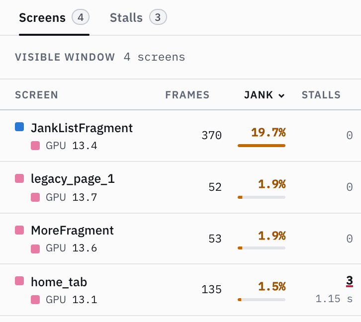
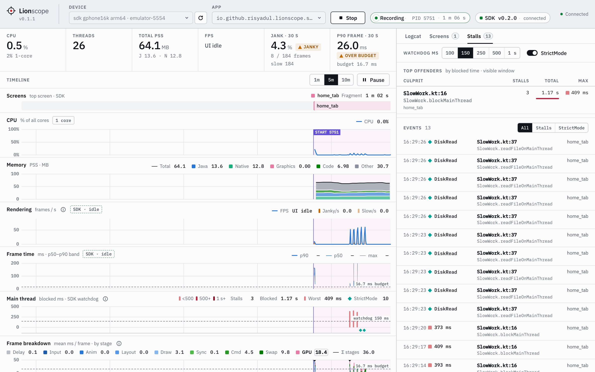

# What the dashboard shows

Device/app selection and session Start/Stop controls stay in the top bar. A labeled left sidebar selects five
workspaces (a drawer on narrow windows):

- **Profiler**: CPU, memory and rendering charts on a shared timeline, logcat below them, and Screens, Stalls,
  Layouts and Saved State analysis tabs alongside. The device mirror is collapsible and becomes a drawer below
  1280 px. Clicking a request on the timeline opens contextual request details without leaving the charts;
  **Open in Network** continues in the dedicated workspace.
- **Layout Inspector**: the device and view hierarchy/property editor, with room for the tree and attributes.
- **Network**: Requests and Mocks, with the device mirror initially shown and available to hide.
- **Storage**: preferences and registered databases, with a source list, grid, and row editor; the device mirror
  starts shown and can be hidden independently from Network. See [Storage](features/storage.md).
- **Device**: the device screen and guidance for letting an AI agent operate it.

A running session keeps recording when workspaces change. Hidden charts stop drawing while retaining their
state, and Storage drafts survive workspace changes on the same app link. Switching apps or SDK connections
clears old Storage drafts. Each workspace is bookmarkable: `?view=inspect`, `?view=network`, `?view=storage`, and
`?view=device`; Profiler uses the default address. Existing Inspector and Device bookmarks still work, and the
viewer remembers the last workspace.

| Panel                                                 | Source                                                                                   | Interval |
| ----------------------------------------------------- | ---------------------------------------------------------------------------------------- | -------- |
| CPU % + threads                                       | `/proc/<pid>/stat`                                                                       | 1 s      |
| Memory (PSS: Java / Native / Graphics / Code / Other) | `dumpsys meminfo --local <pid>`                                                          | 3 s      |
| Frames (FPS, jank, p50/p90 frame time)                | `dumpsys gfxinfo <pid> framestats reset` (+ `/proc/uptime` for device-side elapsed time) | 0.5 s    |
| Logcat (app PID only)                                 | `logcat -v epoch --pid=<pid>`                                                            | stream   |
| Crashes (agents' `get_crashes`)                       | `logcat -v epoch -b crash -T <session start>`                                            | stream   |
| Process start / restart / died markers                | `pidof <pkg>`                                                                            | 1 s      |

With the SDK installed in the app's debug build, the dashboard also shows:

| Panel                                             | Source (in-app SDK)                                         |
| ------------------------------------------------- | ----------------------------------------------------------- |
| Screens lane + tint across all charts             | Activity / Fragment / DialogFragment lifecycle (top screen) |
| Rendering / Frame time (source `SDK`)             | `Window.OnFrameMetricsAvailableListener` (API 24+)          |
| Frame breakdown (input … swap, delay, GPU)        | FrameMetrics stages, aggregated per 500 ms                  |
| Per-screen table (frames, jank %, p90, top stage) | the above, grouped by screen                                |
| Main thread lane (one bar per stall)              | Main-thread watchdog; StrictMode violations as ticks        |
| Stalls tab (offenders, events, stack detail)      | Sampled main-thread stacks; StrictMode violations (opt-in)  |
| Layouts tab, Inflate column, gold lane markers    | XML layout inflation timing (Android 10+)                   |
| Views column (count and depth per screen)         | View hierarchy snapshot after a screen's first frame        |
| Network tab, Network lane, mocks                  | `Lionscope.okHttpInterceptor()` in the app's `OkHttpClient` |

While SDK frames flow, `gfxinfo` polling pauses (no double observation, no `reset` clash); it resumes 3 s after
they stop. The dashboard shows whether the SDK is connected (and its version), or how to add it.

The Screens tab ranks screens by jank % and names the dominant frame stage for each one (p90 and slow frames
join in when the panel is wider). Names come from the app's own screen alias when it has one (`home_tab`,
`legacy_page_1`), otherwise from the class.

The Stalls tab after tapping the sample's Home buttons that block the main thread (directly, from an RxJava
chain and from a coroutine) from the Device column, with the offenders grouped **By origin**: where the work came
from, how often and for how long. **By line** ranks the lines that blocked instead. Each stall is listed with its
duration, its line and its origin; with StrictMode on, disk and network violations join the list with their
stacks.

<!-- docs:added -->

## Each part in detail

- [Finding the line that blocks the main thread](features/stalls.md)
- [Layouts: what inflating XML costs](features/layouts.md)
- [Layout Inspector: pick a view, see where it came from](features/layout-inspector.md), and editing views live
- [Network: requests and mocks](features/network.md)
- [Saved state: what makes it too large](features/saved-state.md)
- [Operating the emulator or a physical device from the dashboard](features/device.md)
- [Changing the device's location](features/location.md)

<!-- /docs:added -->
