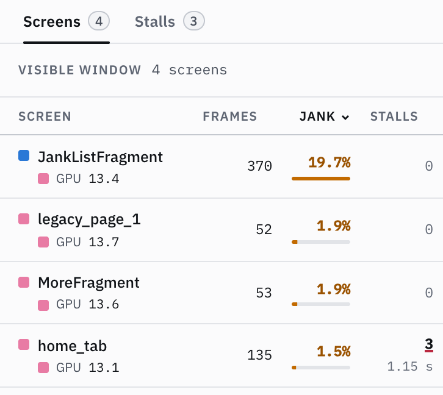
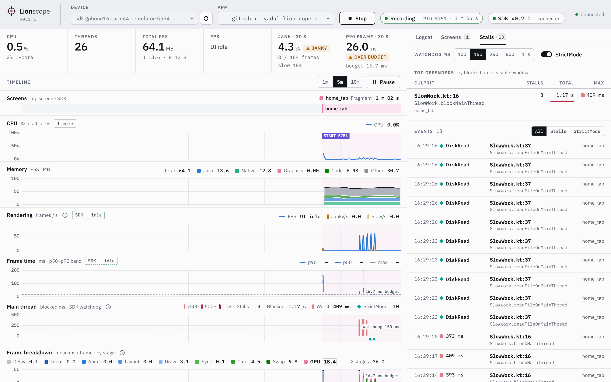

# What the dashboard shows

The dashboard is a single page: a top bar to pick the device and the app and to start or stop a session; the
emulator's screen on the left; stacked timeline charts in the middle that share one time axis (last 1, 5 or 10
minutes) and can be paused, with the app's logcat in a drawer below them (drag its bar to resize it,
double-click the bar to maximise it; click, shift-click or Cmd/Ctrl-click lines and press Cmd/Ctrl+C to copy
them); and, with the SDK, the Screens, Stalls, Layouts and Network tabs on the right. Below 1280 px the screen opens as a
drawer from the top bar (in the Profiler view; the other two keep it on the page).

The switch at the right of the top bar picks what the page is for:

- **Profiler** (the default): everything above.
- **Inspector**: only the device and the [Layout Inspector](features/layout-inspector.md),
  which gets the room to show its tree and the attributes side by side.
- **Device**: only the device screen, larger, with how to let an AI agent operate it (see
  [Use with AI agents](agents.md)).

The Inspector and Device views hide the charts and logcat and stop drawing them, so nothing hidden keeps
redrawing in the browser; a running session keeps recording, and the charts and logcat (with its filters) are
there as you left them when you switch back. The
view is part of the address (`http://localhost:8701/?view=inspect`, `?view=device`), so you can bookmark it, and
the page remembers the last one you used.

| Panel                                                 | Source                                                                                   | Interval |
| ----------------------------------------------------- | ---------------------------------------------------------------------------------------- | -------- |
| CPU % + threads                                       | `/proc/<pid>/stat`                                                                       | 1 s      |
| Memory (PSS: Java / Native / Graphics / Code / Other) | `dumpsys meminfo --local <pid>`                                                          | 3 s      |
| Frames (FPS, jank, p50/p90 frame time)                | `dumpsys gfxinfo <pid> framestats reset` (+ `/proc/uptime` for device-side elapsed time) | 0.5 s    |
| Logcat (app PID only)                                 | `logcat -v epoch --pid=<pid>`                                                            | stream   |
| Crashes (agents' `get_crashes`)                       | `logcat -v epoch -b crash -T <session start>`                                            | stream   |
| Process start / restart / died markers                | `pidof <pkg>`                                                                            | 1 s      |

With the SDK installed in the app's debug build, the dashboard also shows:

| Panel                                             | Source (in-app SDK)                                         |
| ------------------------------------------------- | ----------------------------------------------------------- |
| Screens lane + tint across all charts             | Activity / Fragment / DialogFragment lifecycle (top screen) |
| Rendering / Frame time (source `SDK`)             | `Window.OnFrameMetricsAvailableListener` (API 24+)          |
| Frame breakdown (input … swap, delay, GPU)        | FrameMetrics stages, aggregated per 500 ms                  |
| Per-screen table (frames, jank %, p90, top stage) | the above, grouped by screen                                |
| Main thread lane (one bar per stall)              | Main-thread watchdog; StrictMode violations as ticks        |
| Stalls tab (offenders, events, stack detail)      | Sampled main-thread stacks; StrictMode violations (opt-in)  |
| Layouts tab, Inflate column, gold lane markers    | XML layout inflation timing (Android 10+)                   |
| Views column (count and depth per screen)         | View hierarchy snapshot after a screen's first frame        |
| Network tab, Network lane, mocks                  | `Lionscope.okHttpInterceptor()` in the app's `OkHttpClient` |

While SDK frames flow, `gfxinfo` polling pauses (no double observation, no `reset` clash); it resumes 3 s after
they stop. The dashboard shows whether the SDK is connected (and its version), or how to add it.

The Screens tab ranks screens by jank % and names the dominant frame stage for each one (p90 and slow frames
join in when the panel is wider). Names come from the app's own screen alias when it has one (`home_tab`,
`legacy_page_1`), otherwise from the class.

The Stalls tab after tapping the sample's Home buttons that block the main thread (directly, from an RxJava
chain and from a coroutine) from the Device column, with the offenders grouped **By origin**: where the work came
from, how often and for how long. **By line** ranks the lines that blocked instead. Each stall is listed with its
duration, its line and its origin; with StrictMode on, disk and network violations join the list with their
stacks.
