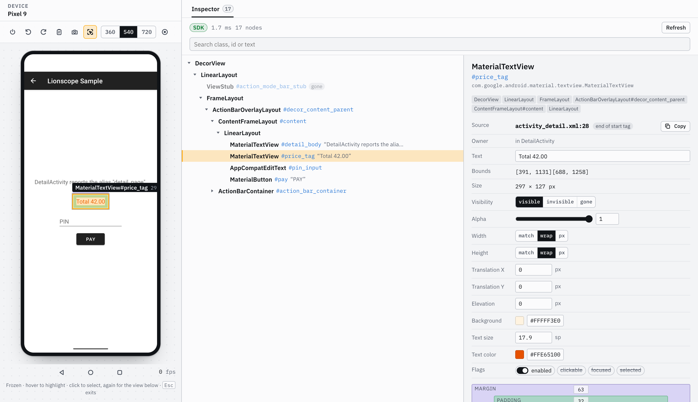
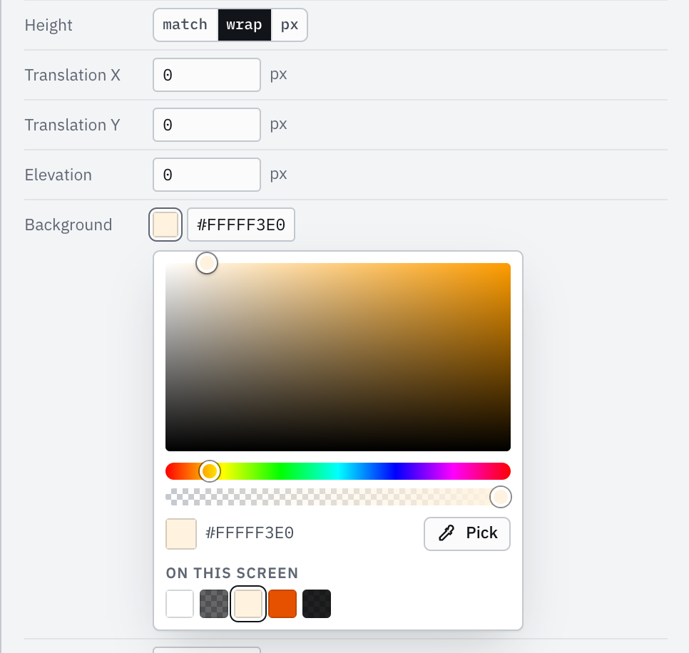

# Layout Inspector: pick a view, see where it came from

Press **Inspect** in the device toolbar (an emulator or a physical device, no profiling session needed). The
screen freezes to a snapshot and the **Inspector** tab opens next to Layouts. Hover to highlight the view under
the pointer (its `Class#id` and size appear on the box); click to select it. The selection shows its padding and
margin on the screen and its attributes in the tab: class, id, text, bounds and size, visibility, alpha, layout
width and height, padding, margin, flags, the owning Fragment and Activity, and the **XML layout and line** it
was inflated from (`fragment_cart.xml:33`). On Compose screens the nodes are **composables** (`Button`,
`ProductCard`) with the **Kotlin file and line they are called from** (`CartScreen.kt:87`). The tree beside it
collapses, follows the selection, takes the arrow keys (↑↓ move, → opens, ← closes) and searches class, id, text,
source file and destination; hovering a row lights up the view on the screen. `Esc` or the toggle goes back to the live screen. While Inspect is on the snapshot refreshes about 0.7 s
after the app changes its top screen (never continuously), and the refresh button takes a new one.

- **Where the tree comes from.** With the SDK in the app (Lionscope 0.5.0 or later) the SDK walks the app's own
  views and the badge reads `SDK`. From SDK 0.9.0 on this needs no profiling session: while a dashboard shows the
  Inspector for a device (the Inspector view or tab), and for 5 minutes after the last Inspect of it (yours or an
  agent's), the server keeps an inspect-only link to the debuggable SDK apps on that device. On that link the SDK
  only reports which screen is on top and answers Inspect: no frames, watchdog, StrictMode or layout reports until
  you press Start. The first Inspect after the link appears can wait up to 6 s for the app to connect (the badge
  then says `SDK connecting` if it didn't). Apps with SDK 0.5.0 or 0.5.1 still link only during a session (badge:
  `SDK needs a session`), and if another Lionscope server already holds the device's link the badge says
  `SDK link busy`. On Android 10 and later that is every window of the app, dialogs included; below
  Android 10 it is the top Activity and its dialogs, and without layout sources. From 0.9.0 the SDK also reads
  Compose (below). Otherwise (no SDK in the app, an older SDK, Compose it cannot read, other apps and system UI) the
  server falls back to the accessibility tree, read by its UI helper (see the agent tools' notes on its side
  effects) or `uiautomator dump`, and the badge says `uiautomator` with the reason. uiautomator has fewer nodes and
  no source, owner, padding or margin; those fields show a dash.
- **Compose.** The SDK (0.9.0 or later, with or without a session) reads the composition of every `ComposeView` (a
  `setContent {}` Activity, a ComposeView in an XML layout, a Compose dialog or popup window), the way Android Studio's Layout Inspector does: it turns
  Compose's tooling data on when it starts, before anything is composed. A node is a composable **called from your
  code**, so `Button` is one but the `Surface`, `Row` and `Layout` inside it are not (calls whose call site is in
  androidx Compose, Material or Navigation are folded into the nearest composable you called; a third-party
  library's internals do show). Its source is the **call site**: the file and line of the call, not where the
  function is defined. Its id is its `testTag`; text, content description and flags come from its semantics;
  lazy list items sit under their list, an `AndroidView`'s View under its composable, a `ComposeView` under the
  XML views around it. Bounds are the content box of what it lays out (inside its padding modifiers); composables
  have no alpha, padding, margin or layout params. With `Lionscope.trackNavigation` (below) the owner shows the
  navigation destination a composable is drawn for. Picking on the screen looks through composables that draw
  nothing themselves (no background, border, image or text: an idle toast or snackbar host spread over the whole
  screen) and have no text, content description, test tag or click; they stay in the tree. Clicking again on the
  same spot steps to the view below. Works with Jetpack Compose 1.6 and later and Compose Multiplatform 1.8+ on
  Android, compiled with source information (the default for debug builds).
- **When Compose falls back.** A Compose screen that was composed before the SDK started (Lionscope installed by
  hand late, or the app opted out with `<meta-data android:name="io.github.risyadul.lionscope.composeInspection"
android:value="false" />`) cannot be read: the badge says why (restart the app). So does a build without
  Compose source information. The tooling data makes composition a little slower and keeps a little more in
  memory (as under Android Studio's inspector), so debug frame timings of Compose screens lean slightly
  pessimistic. A capture runs on the main thread: about 10 ms for a 30-item lazy list on an emulator, several
  times that on a slow phone; reading compositions stops after 200 ms (the snapshot is then marked truncated).
- **The line number is where the start tag ends.** aapt2 records the line of the closing `>`, so a `Button` that
  spans lines 28 to 33 reports 33. Views built in code, ViewStubs and views inflated off the main thread have no
  source, and neither do the views of an Activity that was created while inflation tracking was off (or opted out
  of in the SDK) — turn it on and reopen the screen.
- **Privacy.** The screenshot and the text on screen stay on your machine, and the snapshot is kept in the
  server's memory only (the last few). Password fields are never read: for Compose, text fields with password
  semantics (`PasswordVisualTransformation`, secure text fields) or a password content type, and a field once
  seen as one stays redacted when "show password" turns that off. A Compose field that only ever sets
  `KeyboardType.Password` shows its text on screen and is read like any other. An AI agent sees text and a cropped image
  only for an element _you_ selected (never for a whole window or a large part of the screen); an element the
  agent selects itself gives it structure only (class, id, layout source, owner, bounds). A view an agent
  selected is marked **AI** in the dashboard. See "Use with AI agents".

## Editing views live

With SDK 0.9.0 or later in the app, the attributes of a selected **View** can be changed on the running app, to try
a fix before touching the layout file: visibility, alpha, enabled, padding and margins (the box-model figure takes
a number per side), layout width and height (`match_parent`, `wrap_content` or pixels), translation, elevation and
the background color, and on a TextView its text, text size (sp) and text color (`#RRGGBB` or `#AARRGGBB`). Edit a
field and press Enter or leave it (Esc puts it back); the server applies it through the SDK and takes a new snapshot
right after, keeping the view selected.

A color field's swatch opens a picker: drag the square and the hue and alpha sliders, click one of the colors the
screen already uses or a recent one, or press **Pick** and click any pixel of the frozen screen with the mouse (Esc cancels the
pick). The color is sent when you let go, not on every step.

Editing needs a **profiling session** (press Start): the app takes edits only from a link whose welcome carried the
link proof (see [Security model](../security.md)), and an inspect-only link never has one. Without a session the
Inspector still shows every value, read-only, and says to press Start; a session whose link key could not be handed
to the app says so too.

- **Temporary.** An edit lasts until you revert it, the app sets that property itself (a RecyclerView row being
  rebound, a data binding) or the view is recreated (rotation, a new Activity or Fragment). The SDK keeps each
  original value: every edited field has a **Revert** button, and the tab's header shows "N live edits
  (temporary)" with **Revert all**. A value the app has set since is left alone, never "reverted" over.
- **What can't be edited.** Composables (change them in code: the tab shows the call site), uiautomator
  snapshots, apps with an SDK older than 0.9.0, and the text of password fields, which is never read, shown or set.
  Margins need `MarginLayoutParams`; a window's root view has no layout size to edit, and an autosizing TextView no
  text size.
- **A background color replaces the background.** Until it is reverted the view has a plain color instead of its
  shape, ripple or image, and its background tint is off (else it would tint the color). Revert puts the original
  drawable and its tint back and keeps the view's padding as it is then. An edited text loses its styling until reverted; styled text is
  restored with its spans, or as plain text when the app's own spans (a clickable link) styled it.
- **It runs the app's own code.** Only the platform setters are called (`setPadding`, `setText`, ...), but they can
  trigger the app's listeners: a `TextWatcher` sees edited text, a custom view's `setPadding` override runs. Values
  are bounded (padding 0–2000 px, margins ±2000 px, sizes up to 10000 px, text up to 500 characters without control
  or bidi override characters, text size 1–200 sp) and edits are rate-limited per device.
- **Agents** with device control can do the same with `set_view_property` and `revert_view_properties` during a
  session (`inspect_screen` and `get_inspector_selection` say which properties a node accepts, or why none).
- **Revert needs the session too.** Edits made in a session stay in the app after it stops (they are its views'
  state now); start one again to revert them, or restart the app.
