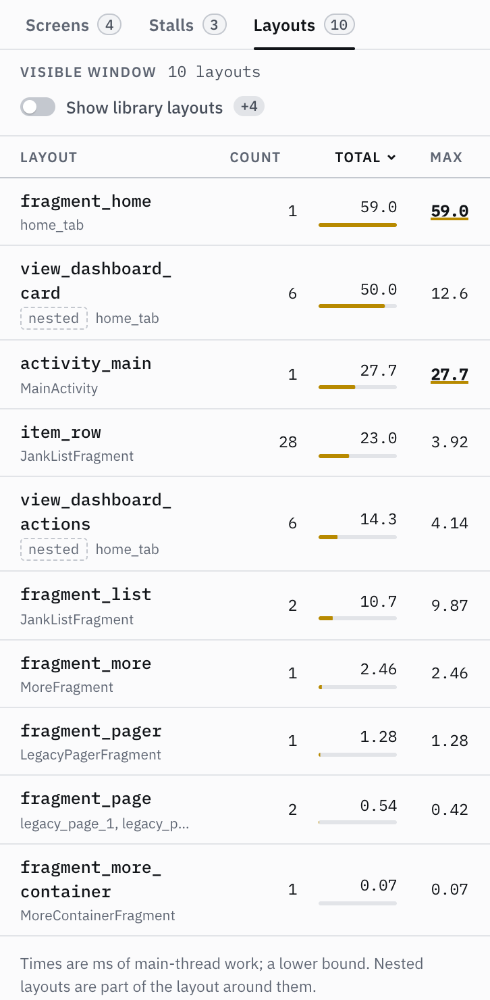

# Layouts: what inflating XML costs

With the SDK (0.4.0+ SDK and server), the **Layouts** tab lists the XML layouts the app inflates on the main
thread through an `AppCompatActivity`'s inflater: how often, total, mean and slowest time, the views created by
the slowest inflation, and the screens it ran on. It is sorted by total time; click a column to sort by it.
Layouts that come from the Android framework or libraries (`abc_`, `mtrl_`, `design_`, …) are hidden until you
switch on **Show library layouts**. A layout the SDK cannot name is shown by its first view and XML line
(`Button:12`, in italics). A layout inflated inside another one (an `<include>`, or a compound view's own
layout) gets its own row, marked **nested**, because that is its own cost; but its time is already part of the
layout around it, so the row is not extra time.



<sub>The Layouts tab after opening the sample's screens: `fragment_home` is the slowest single inflation, its
included cards (`view_dashboard_card`, nested) make up most of it, and `item_row` adds up over 29 RecyclerView
rows.</sub>

The Screens tab gets an **Inflate** column (inflation time on that screen, each inflation counted once and nested
ones left out, the slowest layout in the tooltip) and a **Views** column (views and depth from the screen's
latest view tree, the deepest path in the tooltip). Top-level inflations of 16 ms or more also appear as gold
bars on the rail under the Main thread lane's baseline; hover one for the layout, its time, its views and the
screen, click it to open the Layouts tab.

How it is measured: the SDK installs a `LayoutInflater.Factory2` on each Activity before it is created and
times view creation from the first view of a layout to the last, then hands the work on (AppCompat's view
substitution, `MaterialButton` and friends, is untouched). No Gradle plugin and no app changes. Read the figures
as a **lower bound**: parser setup is not included, and a debuggable build is slower than release.
What is **not** measured: inflation through the application context or in a `Service`, on a background thread,
in Activities created while tracking was off, in Activities that already had a `LayoutInflater` factory, and
in screens that are not `AppCompatActivity` (plain `Activity` and `ComponentActivity` screens; their view trees
are still taken). Layout measuring needs
**Android 10 (API 29)+**; below that the tab says so and nothing is installed. Inflation tracking is on by
default and has a switch next to StrictMode in the Stalls tab. Turning it off stops recording, and screens
opened afterwards get no factory at all (also across reconnects, until a session turns it back on); screens
opened while it was on keep theirs.

**If your app sets its own factory.** The SDK only installs its factory when the Activity's inflater has none.
If the app (or a library) later calls `LayoutInflater.setFactory2` on that same inflater, for example in
`onCreate` after `super.onCreate`, Android throws `A factory has already been set on this LayoutInflater`. The
dashboard switch can't help there, because the first Activity is created before the SDK hears from the server.
Turn inflation measuring off for the app in its debug manifest instead (view trees keep working):

```xml
<!-- src/debug/AndroidManifest.xml -->
<application>
    <meta-data android:name="io.github.risyadul.lionscope.inflateTracking" android:value="false" />
</application>
```

And please open an issue with the stack trace.

**View trees.** Once per screen visit, after its first frame and when the main thread is idle, the SDK walks
the window's view hierarchy (iteratively, capped at 20,000 views) and reports the number of views and view
groups, the depth, the path to the deepest view and the most common view classes. This works on every API level
the SDK supports, including those below Android 10.
