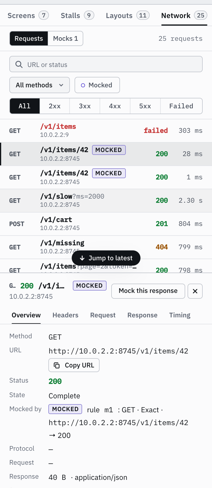

# Network: requests and mocks

With SDK 0.9.0 or later and one line in the app's `OkHttpClient`, the **Network** tab lists the app's HTTP requests
during a profiling session: method, host and path, status, duration and size, with failed, pending and mocked ones
marked; filter by text, method and status class (2xx … 5xx, failed). Select one for its overview, request and
response headers, bodies (JSON pretty-printed) and timing (waiting for the headers, then reading the body). The
**Network** lane on the timeline shows each request as a bar from start to end, coloured by status; click one to
open it in the tab.



```kotlin
// Retrofit (OkHttp 4.x or 5.x): add it last, after the app's own interceptors
val client = OkHttpClient.Builder()
    .addInterceptor(authInterceptor)
    .addInterceptor(Lionscope.okHttpInterceptor())
    .build()
val retrofit = Retrofit.Builder().baseUrl("https://api.example.com/").client(client).build()

// Ktor on Android (OkHttp engine), in androidMain
val http = HttpClient(OkHttp) { engine { addInterceptor(Lionscope.okHttpInterceptor()) } }
```

The release build keeps the same line with `lionscope-noop`, whose interceptor just passes requests on. Lionscope
does not bring OkHttp; the app's own is used. Added last, the capture sees what the app's interceptors (auth,
logging) send, and mocked responses go back through them. Added with `addNetworkInterceptor` instead, it records
but never mocks.

**What it captures.** Only while a profiling session runs (not on the Inspector's session-free link, and not
without a dashboard: then it is a plain `chain.proceed`), and only on a link the SDK has verified as the real
server (see [Security model](../security.md); the dashboard says when it couldn't). Bodies of text types (JSON, XML, `text/*`, forms,
GraphQL), the first 64 KB of each; other bodies (images, multipart, protobuf, downloads) only by size and type.
Server-sent events and WebSocket upgrades are shown without their stream. A body the app sets
`Accept-Encoding: gzip` for itself is unzipped for display; Brotli and other encodings are flagged, not decoded.
The response body is never read by Lionscope: it copies what the app reads, so the app reads it exactly once and the
request ends (in the list) when the app finishes reading it. An error inside Lionscope never fails or changes the
app's call. At most 20 requests per second are recorded; the rest are counted.

**Privacy.** Values are replaced with `‹redacted›` on the device, and again by the server: `Authorization`,
`Proxy-Authorization`, `Cookie` and `Set-Cookie`, and every header, query or fragment parameter, form field, JSON key
(at any depth) and XML element or attribute whose name contains `token`, `secret`, `api-key` / `api_key` / `apikey`,
`auth`, `session`, `password` / `passwd`, `credential`, `signature`, `jwt` or `appcheck`, is `key`, `code`, `sig`,
`pass` or `pwd`, or ends in `-key`, `_key`, `Key` (and the like for `sig`, `pass`, `pwd`). User names and passwords
in URLs (`user:pass@`) and the query of URLs in `Location`, `Content-Location`, `Referer` and `Link` headers are
redacted too, and so are URLs and such pairs inside error messages. `search_logcat` redacts log messages the same
way before it matches or returns them (header lines, JSON, `name=value` pairs, URLs, plus `Bearer` values and JWTs);
the dashboard's Logcat panel shows lines as logged. For `get_crashes` the server reads the crash buffer of the whole
device: crash lines of other apps are passed over and never stored, and the app's own are stored redacted. Redaction
goes by name: a secret under an
innocent name (`"data": "<token>"`) or in a GraphQL query's text is not caught. Requests stay in the server's
memory only (the last 10 minutes, at most 5000 requests or 32 MB) and are never written to disk. AI agents get the list, headers and timings, but bodies only when you opt in
with `--allow-network-bodies` (see [Use with AI agents](../agents.md)).

**Mocks.** **Mock this response** on a request (or **New mock** in the Mocks list) opens the mock editor: a method
(or any), a URL pattern (**exact**, **prefix**, or a **glob** where `*` matches anything, `/` included; the query is
ignored unless the pattern has a `?`), and the answer: a response (status, headers, body up to 256 KB) or a failure
(**timeout** or **connection error**, which the app sees as an `IOException`), after an optional delay of up to
30 s. A mocked request never reaches the network. When several rules match, exact wins over prefix over glob, then
the longer pattern, then a rule for that method over one for any method, then the newest. Rules belong to the
running session: they are cleared when it stops. While any are on, the top bar says **N mocks active** in every view
(and whether the app has them yet); each mocked request is marked **Mocked**, and the app's logcat gets one
`Lionscope` line per mocked request. Up to 32 rules.

In the Inspector and Device views the Network tab is not shown, but requests keep being recorded and the mocks
indicator stays; click it to go back to the Mocks list. To try it, the sample app's **More → Open the network
demo** calls a small local API: `node android-sdk/sample/sample-api.mjs`, reached from an emulator at
`http://10.0.2.2:8745`.
