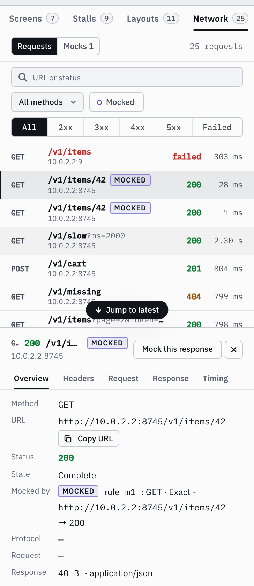

# Network: requests and mocks

With SDK 0.9.0 or later and one line in the app's `OkHttpClient`, the **Network** tab lists the app's HTTP requests
during a profiling session: method, host and path, status, duration and size, with failed, pending and mocked ones
marked; filter by text, method and status class (2xx … 5xx, failed). Select one for its overview, request and
response headers, bodies (JSON pretty-printed) and timing (waiting for the headers, then reading the body). The
**Network** lane on the timeline shows each request as a bar from start to end, coloured by status; click one to
open it in the tab.



```kotlin
// Retrofit (OkHttp 4.x or 5.x): add it last, after the app's own interceptors
val client = OkHttpClient.Builder()
    .addInterceptor(authInterceptor)
    .addInterceptor(Lionscope.okHttpInterceptor())
    .build()
val retrofit = Retrofit.Builder().baseUrl("https://api.example.com/").client(client).build()

// Ktor on Android (OkHttp engine), in androidMain
val http = HttpClient(OkHttp) { engine { addInterceptor(Lionscope.okHttpInterceptor()) } }
```

The release build keeps the same line with `lionscope-noop`, whose interceptor just passes requests on. Lionscope
does not bring OkHttp; the app's own is used. Added last, the capture sees what the app's interceptors (auth,
logging) send, and mocked responses go back through them. Added with `addNetworkInterceptor` instead, it records
but never mocks.

**What it captures.** Only while a profiling session runs (not on the Inspector's session-free link, and not
without a dashboard: then it is a plain `chain.proceed`), and only on a link the SDK has verified as the real
server (see [Security model](../security.md); the dashboard says when it couldn't). Bodies of text types (JSON, XML, `text/*`, forms,
GraphQL), the first 64 KB of each; other bodies (images, multipart, protobuf, downloads) only by size and type.
Server-sent events and WebSocket upgrades are shown without their stream. A body the app sets
`Accept-Encoding: gzip` for itself is unzipped for display; Brotli and other encodings are flagged, not decoded.
The response body is never read by Lionscope: it copies what the app reads, so the app reads it exactly once and the
request ends (in the list) when the app finishes reading it. An error inside Lionscope never fails or changes the
app's call. At most 20 requests per second are recorded; the rest are counted.

**Original debug data.** With negotiated device protocol 14, Network keeps the original captured URLs,
headers (including Authorization, Cookie and Set-Cookie), request/response body text and failure messages.
No credential censoring is applied to this stream. Capture still requires an active profiling session and the
SDK link proof. Size, rate, text-type and streaming limits above still apply. An older SDK or server negotiating
protocol 13 or below retains its legacy credential redaction policy; update both and capture new requests.
Previously redacted data cannot be recovered.

**Copy cURL.** The selected request has a **Copy cURL** action. It copies a POSIX-shell command, including
captured authentication headers and body text, without executing it. Values are quoted as literal arguments;
`--data-raw` preserves a leading `@` as data. cURL supplies Content-Length/Transfer-Encoding framing itself;
other captured headers, including repeated and empty headers, are retained. The body’s Content-Type is added
when the interceptor’s header snapshot does not yet include it. Redirect following and retries are not enabled.
This replays the interceptor’s captured request, rather than reproducing TLS settings or headers added by later
interceptors, OkHttp’s cookie jar or transport. It does not refresh an expired token.

Copy is disabled with a visible reason for legacy captures, missing details, shortened URLs/headers, omitted or
truncated bodies, NUL bytes, compressed request bodies or a body whose bytes do not round-trip as UTF-8.
Decoded non-UTF-8 and compressed response text remains viewable. A complete request can be copied while its
response is still pending. The command targets macOS/Linux POSIX shells, not PowerShell or Windows cmd.
See the [cURL manual](https://curl.se/docs/manpage.html#--data-raw) for the command’s data and header syntax.

Requests stay in server memory only (the last 10 minutes, at most 5000 requests or 32 MB). Copying explicitly
puts the command and its credentials on the system clipboard. AI agents get original URLs, headers and timings;
body text still requires `--allow-network-bodies` (see [Use with AI agents](../agents.md)). App data stays marked
as untrusted in tool results.

**Other redaction policies.** `search_logcat` still redacts log messages before matching or returning them;
the dashboard Logcat panel shows lines as logged. `get_crashes` still excludes other apps and redacts the
selected app’s crash lines. Network’s original-value policy does not change either policy.

**Mocks.** **Mock this response** on a request (or **New mock** in the Mocks list) opens the mock editor: a method
(or any), a URL pattern (**exact**, **prefix**, or a **glob** where `*` matches anything, `/` included; the query is
ignored unless the pattern has a `?`), and the answer: a response (status, headers, body up to 256 KB) or a failure
(**timeout** or **connection error**, which the app sees as an `IOException`), after an optional delay of up to
30 s. A mocked request never reaches the network. When several rules match, exact wins over prefix over glob, then
the longer pattern, then a rule for that method over one for any method, then the newest. Rules belong to the
running session: they are cleared when it stops. While any are on, the top bar says **N mocks active** in every view
(and whether the app has them yet); each mocked request is marked **Mocked**, and the app's logcat gets one
`Lionscope` line per mocked request. Up to 32 rules.

In the Inspector and Device views the Network tab is not shown, but requests keep being recorded and the mocks
indicator stays; click it to go back to the Mocks list. To try it, the sample app's **More → Open the network
demo** calls a small local API: `node android-sdk/sample/sample-api.mjs`, reached from an emulator at
`http://10.0.2.2:8745`.
