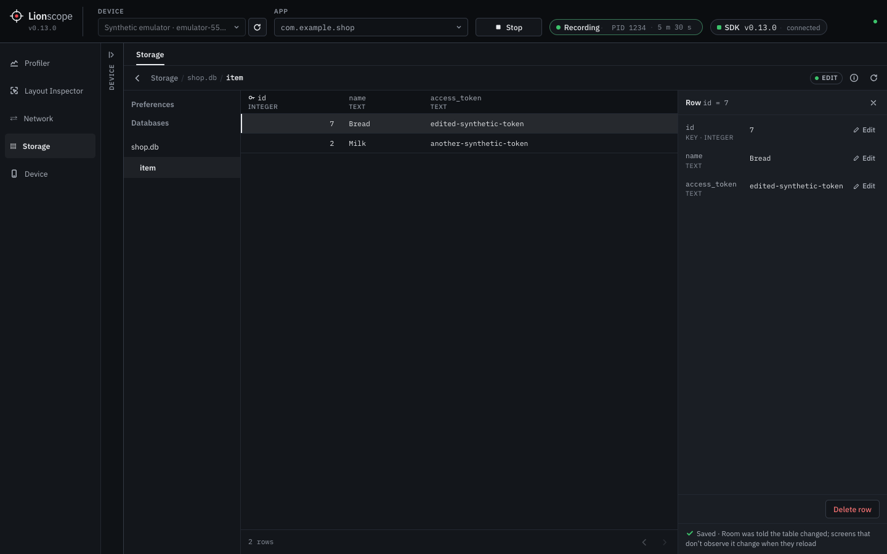
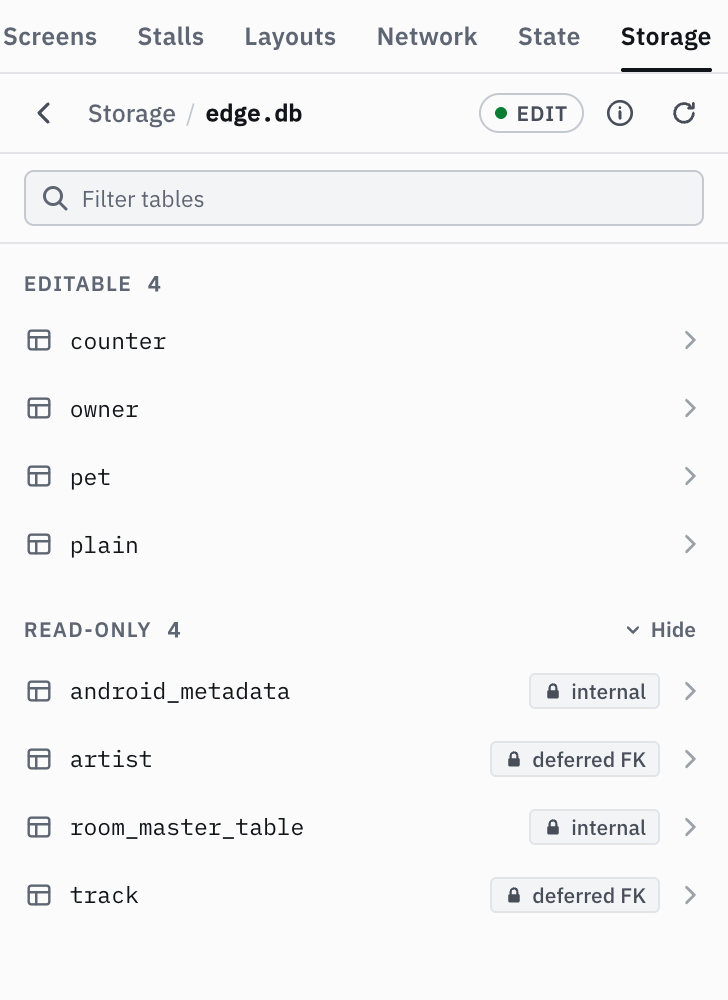

<!-- docs:added -->

# Storage: reading and editing app data live

The profiled app's SharedPreferences and the Room databases it registers, from the dashboard's **Storage** workspace or
an AI agent (`list_storage`, `read_storage`, `write_storage`, `get_storage_audit`). Needs SDK 0.13.0 or newer; original values and atomic row edits require device protocol 12 on both sides. The dashboard's SQL Query console requires device protocol 13.

<!-- /docs:added -->



## Turning it on

Storage is off unless the server starts with it:

```sh
npx lionscope --allow-storage-read                        # read only
npx lionscope --allow-storage-read --allow-storage-write  # read and edit
```

Without `--allow-storage-read` the agent tools are not registered and the tab says how to turn it on; nothing is
sent to the device. It works through the profiling session's SDK link, so start a session first. A link without
its link proof is refused (`unauthenticated`) before anything is sent.

## Registering a database

Prefs files are found on their own. A Room database is read only once the app registers the instance it uses:

```kotlin
val db = Room.databaseBuilder(context, ShopDatabase::class.java, "shop.db").build()
Lionscope.trackDatabase("shop.db", db)
```

The no-op artifact has the same call, so release builds need no change. Lionscope keeps the instance only weakly
(a database the app dropped lists as `unsupported:closed`), at most 16 of them; registering a name again replaces
it. A database opened through a `SQLiteDriver` (Room 2.7 `setDriver`) lists as `unsupported:driver`.

## Where it was proven

Runtime-verified on an Android emulator with API 28 and Room 2.7.2 (the sample app's versions). Android 15/16
(API 35/36), physical devices (such as HyperOS) and Room 2.6.x have not been verified yet: treat them as unproven
until they are.

## What it does to the app

- **No second connection.** Every read and write goes through the app's own `RoomDatabase.runInTransaction`, never
  a connection of Lionscope's, a checkpoint or a copy of the file. Pages of one request are read in one
  transaction, consistent within that read only.
- **A read holds the app's writers while it runs.** Its 250 ms budget is cooperative, not a deadline: it is
  checked between SQL statements, counted from when the transaction was got, and a request past it rolls back and
  answers `timeout`. A slow statement runs to its end first, so the writers can be held longer than 250 ms (one run
  measured 320 ms). Waiting for the app's connection is not bounded either: while the app holds a long transaction,
  the storage thread waits for it (it cannot be interrupted), and other storage requests meanwhile are `busy`.
- **One request at a time** per device, on the SDK's `lionscope-storage` thread, never the main thread. Another
  request meanwhile is `busy`.
- **Prefs are the app's own instance, main process only.** A value is what that `SharedPreferences` holds in
  memory, which may differ from the file. A prefs file that a `:remote` (or any other) process writes is not
  seen from there, and an edit made here does not reach that process.
- **Reading a prefs file loads it.** Only names in the listing are opened, through the app's own
  `getSharedPreferences`; one the app had not opened yet is then loaded and stays cached in its process, as if the
  app had opened it.

## Reading

An answer is at most 240 KiB. A prefs page or a table page that would be larger is cut: it says `truncated`, and
its `nextCursor` continues after the last key or row sent (the dashboard's **Next**). A row too large on its own is
sent with its values cut (read-only) on a page of its own. A prefs key longer than 1024 characters is shown cut
with its length (`keyLength`), and is read-only: its first 1024 characters may be another key of the file. A table of
more than 256 columns shows its first 256 and is read-only (`truncated`); a row's digest always covers every column.

A `nextCursor` is an opaque token (`c1.` and 32 hex digits) that the SDK keeps for that prefs file or table: it
never carries a key or a value, so a credential used as a primary key cannot leak through it. Tokens last as long
as the app's link: after a reconnect, or an unknown token, the read answers `invalid_identifier`; read from the
start again.

Every answer names the app link it came from (`target`: device, package and link generation). An edit carries the
`target` of the values it was made from, and is refused (nothing sent to the app) when the app's link is another
one now: another app, a restart or a reconnect. The dashboard drops everything it read when the session, its app or
its process changes, and an answer for a file or table that is no longer shown is dropped.

## Query console

Load Storage, select a database or table, then **+ New Query**. The editor stays beside the source browser;
**Tables** returns to the table inspector. Choose the execution database, enter SQL and press **Run** or
Ctrl/Command+Enter. A text selection runs only that selection. Each Run accepts one statement:

```sql
SELECT category, SUM(qty) AS total FROM item GROUP BY category;
```

SELECT, JOIN, WHERE, GROUP BY and WITH are supported. INSERT, UPDATE and DELETE require
`--allow-storage-write` as well as read access. These explicit SQL mutations change matching rows directly,
without compare-and-set or undo. They report affected rows; timeouts and disconnects are uncertain and never
trigger an automatic retry. A late final result updates the original execution. Table drafts and undo offers are
discarded before a SQL mutation attempt; returning to Tables refreshes the data.

History holds at most 20 statements in memory for this app link. Choosing one loads it without running it.
Changing database clears results, and a new session or SDK link clears the editor, history and results. Query
results are read-only projections; use Tables for conditional row edits. Query text is never written to audit
metadata, logs or browser storage. SQLite error text is displayed as untrusted app data.

SQL is capped at 16,384 characters. Results use exact typed values, up to 200 rows per request (50 in the UI),
256 columns and 240 KiB per reply. Column labels longer than 128 characters and large cells may be shortened;
the result reports truncation. Next advances by the number of returned rows. Each page executes a new read,
so use ORDER BY and expect concurrent app changes between pages.

The console executes through the registered Room instance and its transaction. It excludes DDL, PRAGMA,
ATTACH/DETACH, transaction commands, multiple statements, parameter placeholders, RETURNING and ROLLBACK
conflict actions. Mutations retain the table inspector's technical restrictions below. A schema containing
ROLLBACK behavior also refuses SQL mutations conservatively, including trigger paths. A temporary table or view
shadowing the target table is refused, and temporary triggers participate in deferred-key checks. The existing cooperative
transaction budget applies; it cannot interrupt a slow statement. Query execution is covered by JVM/SQLite JDBC
and synthetic browser tests, not yet by Android device runtime evidence.

## Editing

Row-editor edits are compare-and-set: each changed field carries the value it was read as, and the entire edit is refused
(`conflict`, with current values) when the app changed an edited field since. The row editor updates existing values
and deletes a row by its primary key. SQL inserts and mutations use the separate Query console described above.
Values keep their exact type: a Long stays a decimal string end to end, a float or double is
compared by its raw bits (`0.0` and `-0.0` differ), and a value of another type is `type_mismatch`.

The workspace has a source list on the left, a grid in the center, and a row editor on the right (a sheet in
narrow windows). Room edits are drafts: change any supported fields, including primary-key fields, then **Apply**
them together in one transaction or **Discard** them. BLOBs use standard base64; string sets use JSON arrays of
strings. Preferences are saved per key. Switching workspaces preserves the selection and draft on the same app
link; a new link or app clears them. A conflicting Apply keeps the draft alongside current values for comparison.

Agents can use `op: "updateRow"` with `table`, the original `pk`, and
`edits: [{column, expected, value}]`. With an older SDK, a single-field draft uses the legacy scalar edit; multi-field Apply is refused with
`needs_sdk`. Existing scalar agent edits continue using the v11 contract. Successful row results carry `storedFields`, the confirmed new `pk`, and a new
`rowDigest`. The dashboard follows the new key using that transaction's readback rather than reopening the old
key; refresh reads the current page again. If a trigger moved or deleted the row beyond the requested new key,
the outcome is still applied, but no confirmed row identity or revert is offered.

What an answer says, and does not:

- **Prefs**: `memory` (applied to the app's instance), `persisted` (`commit()` returned true, false, or is still
  running: `timeout`, with its final outcome following), and `observers: posted_unverified`: Android was asked to
  notify the app's listeners; whether they ran, or the screen shows it, is not known.
- **Prefs compare-and-set is not atomic** against the app: the value is compared, then the edit is committed through
  the app's own instance, and the app can write the same key in between (the later commit wins). Room edits compare
  and write inside one transaction, so they are atomic.
- **Room**: `changes`, and `observers: room_invalidation`: screens that observe the table through Room (`Flow`,
  `LiveData`) refresh; one that loaded once does not until it queries again. `totalChangesDelta` counts triggers and
  Room's own bookkeeping too.
- **Undo** (**Revert row edit** for Room) is offered only after an edit's final answer was `ok` in time (and, for prefs, persisted), and only on the
  link it was made on: after a new session, another app, a restart or a reconnect it is refused. It is itself
  compare-and-set, so it is a `conflict` when the app changed an edited value in between. A row revert restores every field in its Apply, including
  primary keys, in one conditional transaction. Trigger/cascade effects follow database rules; this does not
  restore the entire database or remove trigger-created audit records.
- A delete or update that breaks a constraint (a foreign key still referenced, `NOT NULL`, `CHECK`, `UNIQUE`) is
  `constraint_failed` and rolled back.
- **Deferred foreign keys** (`DEFERRABLE INITIALLY DEFERRED`) are checked only at COMMIT, and on Android a COMMIT that
  fails leaves the app's own connection inside the transaction: the app's next transaction fails, and what it writes
  outside one is lost. So, when a database declares one, the tables an edit could make fail there are read-only
  (`unsupported:deferred_fk`, shown in the schema): a table declaring a deferred key and the tables it references,
  every table with a trigger, and a table whose `ON DELETE` / `ON UPDATE` action (cascade, set null or default)
  reaches one of those. A database without deferred keys is not affected. The schema is read the way SQLite reads
  it (case, comments and line breaks inside the clause do not hide a deferred key; a schema with any unusual character
  outside quotes counts as declaring one).
- **`PRAGMA defer_foreign_keys` left on.** This pragma makes every foreign key of the next transaction deferred
  and can't be seen in the schema. If the app turns it on outside a transaction and leaves it on, a database edit is
  refused (`unsupported:defer_foreign_keys`, nothing written): it is read inside the edit's transaction, before any
  change. SQLite switches the pragma off at the end of every transaction, so any read or edit Lionscope makes also
  switches off a pragma the app left on; a retry then meets immediate keys. Room only uses it inside its own
  transactions.
- **What an edit leaves** is read back inside its transaction. A trigger or another writer may make it larger than
  an answer may carry: it is then shown cut (read-only, so it can't be undone from here), and the outcome is still
  what happened (`ok` with `changes`, never rolled back to make room).
- A prefs edit whose commit outlasts 1 s answers `provisional` first; its `final` answer always comes after it, and is
  recorded (audit, dashboards, agent) even when both arrive together.
- A **lost answer** is a `timeout`: the edit may have been applied. Read again before retrying; a retry of an edit
  that went through may answer `already_applied_or_concurrent` and writes nothing. After a primary-key change,
  read again to locate the row before any deliberate retry.



SQLite and Android facts that show up as answers: a REAL cell cannot hold `-0.0` (written, read back as `0.0`,
`normalized: true`) or NaN (`invalid_value:nan_not_storable`); prefs keep a single NaN (bits `0x7fc00000`), so another
NaN payload is `invalid_value:nan_payload`. Text with a lone surrogate is never written (`invalid_value:lone_surrogate`):
in a TEXT cell, Android's SQLite binding converts UTF-16 to UTF-8 and would change it and the character after it; in a
prefs string or string set, Android keeps it in the app's memory but writes it to the file as `?`, so the app would
read another value after a restart. Text and blobs over 16 KiB are shown cut and are read-only.

## Original values and read-only boundaries

On device protocol 12 links, Storage shows original app values, including credential-looking keys/columns and
credentials inside strings. They are editable under the same write permission as other supported values, in
both the dashboard and AI agents; no additional reveal toggle is needed. Network and Layout Inspector retain
their own redaction policies. An older negotiated link keeps v11 redaction and primary-key restrictions: update
both the server and SDK to use the new behavior.

EncryptedSharedPreferences remain `unsupported:encrypted`. Views, virtual (FTS) tables, Room's own tables, tables
without an explicit primary key, unsupported deferred-foreign-key cases, and truncated values retain their
technical read-only restrictions, each with its reason. Complete, unique, non-NULL primary keys are required to
address a row; changing a key does not bypass `UNIQUE`, foreign-key, `NOT NULL`, or other database constraints.

The audit records who changed what and the outcome, never a value; a primary key is recorded as a digest. It is
kept in the server's memory for its run, and read with `get_storage_audit` or the tab's **Write audit** button.
